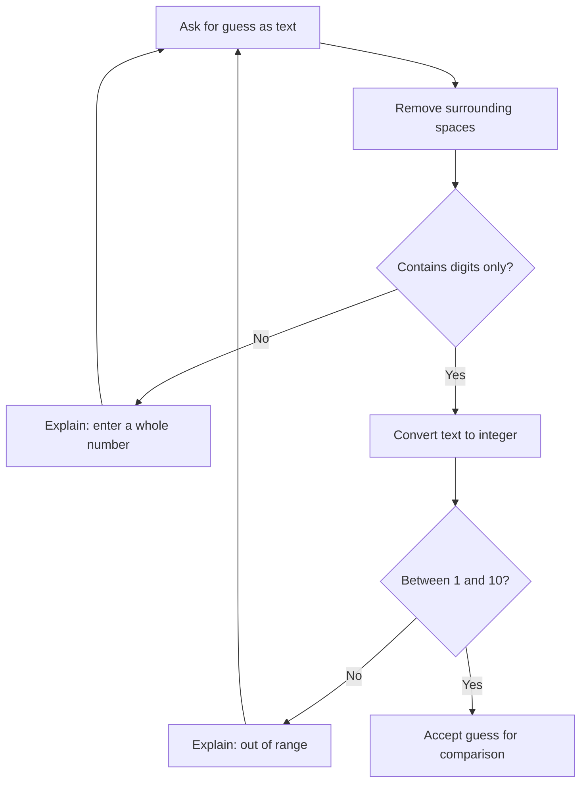

# PROG 1700 — Logic and Programming
## Workshop 04-02 — Input Validation

### 1. Workshop Details

| Field | Details |
|---|---|
| Course | PROG 1700 — Logic and Programming |
| Instructor | Davis Boudreau |
| Series | Workshop 04 — Error Handling (Part 2 of 4) |
| Workshop | 04-02 — Input Validation |
| Type | Self-guided, hands-on programming |
| Estimated time | 75–90 minutes |
| Tools | Python 3, VS Code, Git, GitHub |
| Prerequisite | Workshop 04-01 — Understanding Errors & Debugging |
| Submission | GitHub technical evidence and Brightspace worksheet/reflection |
| Evaluation | A — Attendance; P — Participation; T — Task Progress; F — Focus & Professional Conduct; R — Reflection |

---

### 2. Overview

#### Purpose and use case

You are improving a **Number Guessing Game**. The computer chooses a secret number between 1 and 10. A player enters guesses until they find the secret number.

A usable game must not accept just any value. For example, `0` and `25` are integers, but they are **not valid guesses** for a game limited to 1–10. Text such as `hello` cannot be used directly in a numeric comparison. Your job is to check input before the game acts on it.

**Today's goal:** Accept whole-number guesses from 1 through 10, explain rejected input, and let the player try again. You will use validation rules, not `try`/`except`; exception handling is the focus of Workshop 04-03.

#### Learning objectives

By the end, you can:

1. Explain the difference between data type and acceptable input.
2. Check whether text contains digits using `.isdigit()`.
3. Convert checked text into an integer using `int()`.
4. Check numeric ranges using comparison operators.
5. Use `if`, `elif`, `else`, and `while` to guide program behaviour.
6. Design expected-versus-actual tests, including boundary tests.
7. Investigate and correct a logical validation error in VS Code.
8. Commit and push working code to GitHub.

### 3. Learning Outcomes Addressed

- **Outcome 1:** Translate logic principles into programming code to solve problems.
- **Outcome 2:** Perform input/output operations to retrieve and present data.
- **Outcome 4:** Implement conditional logic to control program behaviour.
- **Outcome 6:** Design and implement loops to perform repetitive tasks.
- **Outcome 7:** Implement debugging techniques using an IDE.

---

### 4. Prior Knowledge Check

Before coding, answer in your worksheet:

1. What does `input()` return in Python?
2. What does `int("5")` produce?
3. What is the difference between `=` and `==`?
4. What does `while` do?
5. Why might `25` be unacceptable even though it is a valid integer?

You may not know every answer yet. Use the activities to discover and revise your answers.

---

### 5. Concepts & Theory — What Does Valid Mean?

There are two different questions:

- **Can the program interpret the input as the expected kind of data?** For this workshop, is it a string of digits representing a non-negative whole number?
- **Does that number satisfy the application's rules?** For this game, is it between **1 and 10 inclusive**?

| Input | Digits only? | Within 1–10? | Accept? |
|---|---|---|---|
| `"5"` | Yes | Yes | Yes |
| `"0"` | Yes | No | No |
| `"11"` | Yes | No | No |
| `"hello"` | No | Not checked | No |
| `"5.5"` | No | Not checked | No |
| `"-2"` | No | Not checked | No |
| `" 5 "` | No before trimming | Yes after trimming | Yes if trimmed |

**Important:** `.isdigit()` is a beginner-friendly way to recognize digit-only strings, not a complete solution for all numeric input. It rejects negative numbers and decimals, which is suitable for this game. In later workshops you will learn other approaches, including exception handling.

#### The validation process



---

### 6. Workshop Challenge — Discuss & Analyze

**Scenario:** A classmate enters `15`, receives “Too high!”, and assumes the game accepted the guess. Another enters `hello` and the program crashes.

Discuss or independently answer:

- Why is “Too high!” insufficient feedback for `15`?
- Which checks should happen **before** comparing a guess with the secret?
- Why should rejected input not count as an accepted guess?

**Prediction:** The correct order is **read → check text → convert → check range → compare**.

---

### 7. Guided Activities — Build, Save, Run, Test

#### Activity 1 — Prepare the project (10 minutes)

1. Open **Visual Studio Code**.
2. Select **File → Open Folder**, and open your PROG 1700 Git repository.
3. Create a folder named `workshop_04_02_input_validation`.
4. Create `guessing_game.py` inside it.
5. Open **Terminal → New Terminal**.
6. In the terminal, change into the workshop folder if needed:

   ```bash
   cd workshop_04_02_input_validation
   ```

7. Verify Python with `python --version`. On Windows you may use `py --version`; on macOS/Linux you may use `python3 --version`.
8. Run the file using the command that works on your system:

   ```bash
   python guessing_game.py
   ```

   If your system uses `py` or `python3`, substitute that command in the rest of the workshop.

**Checkpoint:** Your terminal can run the Python file, even if the file is still empty.

#### Activity 2 — See why direct conversion is risky (10 minutes)

**LEARN:** `input()` returns a string. Calling `int()` immediately assumes that the user entered an integer.

**BUILD:** Type the following into `guessing_game.py`:

```python
raw_guess = input("Guess a number between 1 and 10: ")
guess = int(raw_guess)
print("You entered:", guess)
```

**PREDICT:** What will happen for `5`? What about `hello`?

**SAVE:** Press **Ctrl+S** (Windows/Linux) or **Cmd+S** (macOS).

**RUN:** Execute `python guessing_game.py` in the terminal. Test `5`, then run it again and test `hello`.

**OBSERVE:** `5` converts successfully. `hello` produces a `ValueError` and the program stops.

**RECORD:** Copy the error type and identify the line that failed. Do not use `try`/`except` yet.

#### Activity 3 — Check the text before conversion (15 minutes)

**LEARN:** A string has an `.isdigit()` method. It returns `True` when the string consists of digit characters. `.strip()` removes spaces at the beginning and end.

**BUILD:** Replace the file contents with:

```python
raw_guess = input("Guess a number between 1 and 10: ").strip()

if raw_guess.isdigit():
    guess = int(raw_guess)
    print("Accepted as a whole number:", guess)
else:
    print("Please enter a whole number using digits 0–9.")
```

**PREDICT:** Decide what each input will produce: `5`, `hello`, `5.5`, `-2`, and ` 5 `.

**SAVE → RUN → OBSERVE:** Run the program separately for each value. The program should not crash for these inputs.

**EXPLAIN:** Why must `int(raw_guess)` be inside the `if raw_guess.isdigit():` block?

**Checkpoint:** You can explain how the program avoids attempting an invalid conversion.

#### Activity 4 — Validate the allowed range (15 minutes)

**LEARN:** A value may be a whole number but still violate the rules of the game. Python allows chained comparisons such as `1 <= guess <= 10`.

**BUILD:** Replace the file contents with:

```python
raw_guess = input("Guess a number between 1 and 10: ").strip()

if raw_guess.isdigit():
    guess = int(raw_guess)

    if 1 <= guess <= 10:
        print("Valid game guess:", guess)
    else:
        print("Out of range. Enter a number from 1 to 10.")
else:
    print("Please enter a whole number using digits 0–9.")
```

**PREDICT:** How will `0`, `1`, `10`, `11`, and `hello` behave?

**SAVE → RUN → OBSERVE:** Test all five values. Confirm that `1` and `10` are accepted, but `0` and `11` are rejected.

**CHECKPOINT:** Explain why `11` does **not** cause a `ValueError`, even though the game rejects it.

#### Activity 5 — Repeat until valid input is provided (15 minutes)

**LEARN:** A `while` loop can ask again after unacceptable input. The `break` statement exits the loop when a valid guess has been accepted.

**BUILD:** Replace the file contents with:

```python
while True:
    raw_guess = input("Guess a number between 1 and 10: ").strip()

    if not raw_guess.isdigit():
        print("Please enter a whole number using digits 0–9.")
    else:
        guess = int(raw_guess)

        if 1 <= guess <= 10:
            print("Valid game guess:", guess)
            break
        else:
            print("Out of range. Enter a number from 1 to 10.")

print("The accepted guess was:", guess)
```

**PREDICT:** If you enter `hello`, then `15`, then `7`, how many times will the program ask for input?

**SAVE → RUN → OBSERVE:** Enter those three values in that order.

**EXPECTED:** The first two inputs are rejected; `7` is accepted; the loop ends; the program displays `The accepted guess was: 7`.

**CHECKPOINT:** Explain what `break` does and why the final `print()` is outside the loop.

#### Activity 6 — Integrate validation into the Number Guessing Game (15 minutes)

**BUILD:** Replace the file with this complete version. Read the comments before running it.

```python
import random

secret = random.randint(1, 10)

while True:
    # 1. Retrieve input as text.
    raw_guess = input("Guess a number between 1 and 10: ").strip()

    # 2. Validate the text before conversion.
    if not raw_guess.isdigit():
        print("Please enter a whole number using digits 0–9.")
        continue

    # 3. Convert after checking the text.
    guess = int(raw_guess)

    # 4. Check the game's allowed range.
    if not 1 <= guess <= 10:
        print("Out of range. Enter a number from 1 to 10.")
        continue

    # 5. Compare only accepted guesses with the secret.
    if guess < secret:
        print("Too low! 📉")
    elif guess > secret:
        print("Too high! 📈")
    else:
        print("You got it! 🎉")
        break
```

**LEARN:** `continue` skips the remainder of the current loop iteration and begins the next iteration. `break` exits the loop entirely.

**PREDICT:** Why does an out-of-range number never reach the `if guess < secret:` comparison?

**SAVE → RUN:** Play the game. Try `hello`, `0`, `11`, and valid guesses. Verify that only guesses from 1 to 10 receive “Too low,” “Too high,” or “You got it.”

**CHECKPOINT:** Explain the difference between `continue` and `break` in this program.

---

### 8. Testing & Verification — Boundary Tests

For repeatable tests, temporarily change:

```python
secret = random.randint(1, 10)
```

to:

```python
secret = 5
```

This makes it possible to know the expected result in advance. **Restore the random-number statement after testing.**

| Input | Expected output | Actual output | Pass/Fail |
|---|---|---|---|
| `hello` | Whole-number guidance; ask again | | |
| `5.5` | Whole-number guidance; ask again | | |
| `-2` | Whole-number guidance; ask again | | |
| `0` | Out-of-range message; ask again | | |
| `1` | Too low; ask again | | |
| `10` | Too high; ask again | | |
| `11` | Out-of-range message; ask again | | |
| `5` | Winning message; game ends | | |
| ` 5 ` | Winning message after trimming; game ends | | |

**Testing tip:** Run the program again as needed to test each case. When the secret is `5`, entering `5` ends that game.

#### Debugging investigation — Find a logic bug

1. Temporarily replace `if not 1 <= guess <= 10:` with `if not 1 < guess < 10:`.
2. Predict what will happen when the player enters `1` and `10`.
3. Save and run. Observe that the program incorrectly rejects both boundary values.
4. In VS Code, set a breakpoint on the range-check line by clicking beside its line number.
5. Select **Run → Start Debugging** and choose the Python file debugger if prompted.
6. Enter `1`, then inspect `guess` in the Variables panel. Use **Step Over** to observe the branch taken.
7. Explain why the condition is wrong. Restore `<=` on both sides.
8. Save, run, and retest `1` and `10`.

**Investigation record:**

| Question | Your response |
|---|---|
| What should the program do? | |
| What did it actually do? | |
| Which condition caused the problem? | |
| What correction did you make? | |
| How did you prove it was fixed? | |

---

### 9. Independent Challenge — Count Rejected Inputs

Improve the game so it counts how many entries were rejected **before** the player wins.

**Requirements:**

- Initialize `invalid_attempts = 0` before the loop.
- Add one for each non-digit entry.
- Add one for each out-of-range entry.
- Do **not** add one for valid guesses, even if they are incorrect.
- Display the total when the player wins.

**Guidance:** Locate the two branches that reject input. Update the counter in each branch before `continue`. Test with the fixed secret `5` and this sequence: `hello`, `15`, `3`, `5`. The expected invalid-attempt count is **2**. Restore the random secret afterward.

**Optional extension:** Add a separate `valid_guesses` counter and display it on winning. For the test sequence above, the expected valid-guess count is **2** (`3` and `5`).

---

### 10. Reflection Questions

Answer in your own words:

1. Why should input be checked before calling `int()`?
2. What does `.isdigit()` check? Give an input it rejects.
3. Why is `11` different from `hello` in this program?
4. Why must the range include both `1` and `10`?
5. What is the difference between `continue` and `break`?
6. Describe the logical error introduced in the debugging investigation. How did you prove it was fixed?
7. What is the difference between **input validation** and **exception handling**?
8. What did you learn about testing values at the edges of an allowed range?

---

### 11. Student Deliverables & Submission Guidelines

**Standard workflow:**

**Complete Workshop → Complete Worksheet → Complete Reflection → Commit/Push Technical Evidence → Submit Worksheet to Brightspace**

**Technical evidence:**

1. Save `guessing_game.py` in the Workshop 04-02 folder.
2. Verify that the program works and that random-number generation has been restored.
3. Open VS Code **Source Control** and inspect the changed files.
4. Stage your workshop files, commit with a meaningful message such as `Complete Workshop 04-02 input validation`, and push to GitHub.
5. Open GitHub and verify the commit and file are present.

**Brightspace worksheet:** Submit your prior-knowledge responses, checkpoints, completed testing table, debugging investigation record, independent challenge evidence, and reflection answers. Include a GitHub link if directed by your instructor.

---

### 12. Evaluation Criteria

| Criterion | Evidence |
|---|---|
| **A — Attendance** | Present and engaged during workshop activities |
| **P — Participation** | Predicts outcomes, performs experiments, and investigates unexpected behaviour |
| **T — Task Progress** | Completes guided code, range validation, repeated input, testing, and independent challenge |
| **F — Focus & Professional Conduct** | Follows instructions, troubleshoots systematically, and works respectfully |
| **R — Reflection / Exit Evidence** | Explains validation logic, boundary testing, and the debugging investigation |

---

### 13. Completion & Exit Evidence

Before leaving, demonstrate that you can:

- Explain why `input()` requires checking before numeric conversion.
- Reject non-digit entries without crashing the game.
- Reject integers outside 1–10.
- Accept both boundary values, `1` and `10`.
- Explain why `continue` and `break` behave differently.
- Test using a fixed secret and restore the random secret afterward.
- Correct a deliberately broken range condition.
- Commit and push your code.

**Exit question:** A different program asks for a score between 0 and 100. Which two checks would you adapt from today's game, and why?

**Next workshop: 04-03 — Exception Handling with `try` / `except`.** You will learn how Python can catch conversion errors directly and how that approach differs from checking text before conversion.
