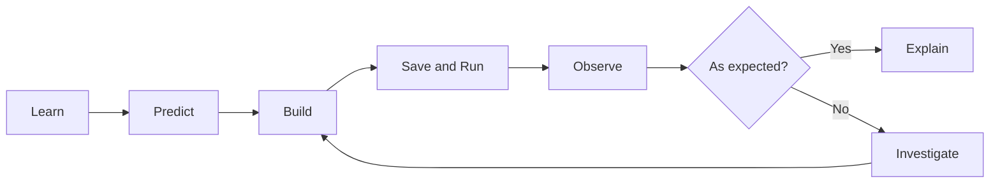
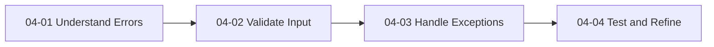

# PROG 1700 — Logic and Programming
## Workshop 04-01 — Understanding Errors & Debugging

### 1. Workshop Details

| Field | Details |
|---|---|
| Course | PROG 1700 — Logic and Programming |
| Instructor | Davis Boudreau |
| Series | Workshop 04 — Error Handling (Part 1 of 4) |
| Workshop | 04-01 — Understanding Errors & Debugging |
| Type | Self-guided, hands-on beginner workshop |
| Estimated time | 60–90 minutes |
| Tools | Python 3, Visual Studio Code, Git, GitHub |
| Submission | GitHub technical evidence and Brightspace worksheet/reflection |
| Evaluation | A — Attendance; P — Participation; T — Task Progress; F — Focus & Professional Conduct; R — Reflection |

### 2. Overview and Use Case

**Scenario:** You are a junior developer building a simple number-guessing game. The computer chooses a secret number between 1 and 10, and the player makes one guess. Before making the game more sophisticated, your job is to understand what happens when code contains mistakes and how to investigate them.

This is **Part 1 of a four-part series**. Today you will build a one-guess prototype, deliberately produce syntax, runtime, and logic errors, read Python error messages, and use VS Code's debugger. In later parts you will add input validation (04-02), exception handling (04-03), and integrated testing/refinement (04-04).

**Learning objectives:** By the end, you should be able to create and run a Python file; identify syntax, runtime, and logical errors; read a traceback; use breakpoints and Step Over; compare expected with actual behaviour; and commit your work.

**Relevant course learning outcomes:** Outcome 1 (translate logic into code), Outcome 2 (input/output), and Outcome 7 (IDE debugging). Outcomes 4 and 6 will be developed further in later parts.

### 3. How This Self-Guided Workshop Works

For every activity, follow **Learn → Predict → Build → Save → Run → Observe → Investigate → Explain**. Your instructor is available to help and will work through the same exercises, but all essential instructions are provided here.



### 4. Prior Knowledge Check

Before writing code, answer briefly:

1. What does `print()` do?
2. What does `input()` do?
3. Why might `int()` be used with `input()`?
4. What might happen if a user enters `hello` when a number is expected?

You are not expected to know every answer yet.

### 5. Concepts and Theory

| Error type | What it means | Typical example |
|---|---|---|
| **Syntax error** | Python cannot interpret the structure of the code. | Missing `:` after an `if` condition. |
| **Runtime error** | Code starts executing but encounters a problem. | `int("hello")` raises `ValueError`. |
| **Logical error** | Code runs, but its result is wrong. | Saying “Too high” when a guess is lower than the secret. |

A **traceback** is Python's report of an unhandled exception. It usually includes a file, line number, exception type, and explanatory message. **Debugging** means using evidence to identify and correct the cause of incorrect behaviour—not changing code randomly.

### 6. Activity 1 — Set Up VS Code and Run a Program

**Step 1.** Launch VS Code. Choose **File → Open Folder**, and open your PROG 1700 Git repository.

**Step 2.** In the Explorer panel, create a folder named `workshop_04_01_error_handling`.

**Step 3.** Inside that folder, create a file named `guessing_game.py`.

**Step 4.** Select **Terminal → New Terminal**. Check your Python installation:

```bash
python --version
```

If necessary, use `py --version` on Windows or `python3 --version` on macOS/Linux. Use whichever command works consistently throughout the workshop. Make sure VS Code's Python extension is installed and the correct Python interpreter is selected.

**Step 5.** Type this code in `guessing_game.py`:

```python
print("Welcome to the Number Guessing Game!")
```

**Step 6.** Save with **Ctrl+S** (Windows/Linux) or **Cmd+S** (macOS).

**Step 7.** In the terminal, change to the workshop folder if necessary and run:

```bash
python guessing_game.py
```

Use `py` or `python3` instead if that is your working command.

**Expected output:**

```text
Welcome to the Number Guessing Game!
```

**Checkpoint:** Confirm the file is saved, the terminal runs the correct file, and the output matches. If you see “file not found,” check the terminal's current folder and the filename.

### 7. Activity 2 — Build a One-Guess Game

**Learn:** The `random` module provides `randint(1, 10)`, which chooses an integer from 1 through 10, inclusive. `input()` returns text; `int()` converts valid numeric text to an integer.

**Step 1.** Replace the file contents with:

```python
import random

secret = random.randint(1, 10)
guess = int(input("Guess a number between 1 and 10: "))

print("Your guess:", guess)
print("Secret number:", secret)
```

**Step 2 — Predict.** What will be displayed if you enter `4`? Which value is random?

**Step 3.** Save and run. Enter `4` and press Enter.

**Step 4.** Run the program again. Does the secret sometimes change?

**Checkpoint:** Identify the `secret` and `guess` variables and explain what each stores.

### 8. Activity 3 — Deliberately Cause a Syntax Error

**Step 1.** Temporarily replace your program with:

```python
number = 5
if number > 3
    print("The number is greater than 3")
```

**Step 2 — Predict.** Does this look valid? What punctuation might be missing?

**Step 3.** Save and run. Read the terminal carefully. You should see a `SyntaxError` pointing to the `if` statement.

**Step 4.** Correct the line to `if number > 3:`. Save and run again.

**Expected output:** `The number is greater than 3`

**Record:** Error type, line involved, correction, and how you verified the fix.

**Step 5.** Restore the working one-guess game from Activity 2 before continuing.

### 9. Activity 4 — Deliberately Cause a Runtime Error

**Step 1.** Run your one-guess game and type `hello` instead of a number.

**Step 2.** Observe the traceback. Look for a message similar to:

```text
ValueError: invalid literal for int() with base 10: 'hello'
```

**Step 3.** Find the line containing `int(input(...))`. Identify which part fails and why.

**Step 4.** Run the program again and enter `5` to confirm the program still works for numeric input.

**Checkpoint:** Explain why this is a runtime error rather than a syntax error. **Do not add `try/except` yet**; exception handling is taught in Workshop 04-03.

### 10. Activity 5 — Find a Logical Error

**Learn:** A logical error may not display any traceback. The program executes but gives the wrong answer.

**Step 1.** Replace the program with this predictable version:

```python
secret = 5
guess = int(input("Guess a number between 1 and 10: "))

if guess < secret:
    print("Too high!")
elif guess > secret:
    print("Too low!")
else:
    print("You got it!")
```

**Step 2 — Predict.** If you enter `3`, what should the message be? If you enter `8`, what should it be?

**Step 3.** Save and run with `3`. Observe the incorrect message.

**Step 4.** Run again with `8`. Observe the incorrect message.

**Step 5.** Correct the two messages so that lower guesses display **Too low!** and higher guesses display **Too high!**

**Step 6.** Test `3`, `8`, and `5`. Complete the table:

| Guess | Expected message | Actual message | Pass/Fail |
|---|---|---|---|
| 3 | Too low! | | |
| 8 | Too high! | | |
| 5 | You got it! | | |

**Checkpoint:** Why did Python not report an exception for the original incorrect messages?

### 11. Activity 6 — Inspect Variables with the VS Code Debugger

**Step 1.** Keep `secret = 5` so the results are predictable.

**Step 2.** Click in the left margin beside `if guess < secret:` to add a red breakpoint.

**Step 3.** Select **Run → Start Debugging**. If prompted, choose the Python File debugger. Enter `3` when the program asks for a guess.

**Step 4.** When execution pauses, open the **Run and Debug** panel and find `secret` and `guess` under **Variables**. They should show `5` and `3`.

**Step 5.** Use **Step Over** (usually F10) to move through the next statements. Observe which branch executes.

**Step 6.** Repeat with `8` and `5`. Observe how the selected branch changes.

**Checkpoint:** Explain how a breakpoint differs from an error. Record one thing the debugger revealed that was not obvious from the final output alone.

### 12. Integrated Challenge — Repair the Game

Return to the random-number version and add correct one-guess feedback:

```python
import random

secret = random.randint(1, 10)
guess = int(input("Guess a number between 1 and 10: "))

if guess < secret:
    print("Too low!")
elif guess > secret:
    print("Too high!")
else:
    print("You got it!")
```

**Your tasks:**

1. Save and run the program.
2. Explain the meaning of each variable and each comparison.
3. Temporarily set `secret = 5` and test guesses `3`, `8`, and `5`.
4. Deliberately swap two feedback messages, identify the logical error using testing, and repair it.
5. Restore `secret = random.randint(1, 10)`.
6. Run once more with a valid number.

**Scope for Part 1:** It is expected that entering text such as `hello` still causes an unhandled `ValueError`. You will fix that in Workshop 04-03. The game also accepts only one guess for now; repetition and validation will be developed in Workshop 04-02.

### 13. Testing and Verification Checklist

- [ ] I created and ran a Python file in VS Code.
- [ ] I can identify the `secret` and `guess` variables.
- [ ] I deliberately created and repaired a syntax error.
- [ ] I deliberately caused a `ValueError` and read the traceback.
- [ ] I found and repaired a logical error.
- [ ] I tested low, high, and correct guesses using a fixed secret.
- [ ] I set a breakpoint and inspected variables in VS Code.
- [ ] I restored the random secret number in the final file.

### 14. Reflection Questions

Answer in your own words:

1. What is the difference between a syntax error, runtime error, and logical error?
2. Which line caused the `ValueError` when you entered `hello`, and why?
3. Why is using a fixed secret number useful while testing?
4. How did you detect the incorrect high/low feedback when Python reported no error?
5. What did you observe using a breakpoint in VS Code?
6. What will your program need to do in future workshops to handle invalid input without crashing?

### 15. Student Deliverables and Submission

Follow the standard workflow:

**Complete Workshop → Complete Worksheet → Complete Reflection → Commit/Push Technical Evidence → Submit Worksheet to Brightspace**

**GitHub evidence:** Commit `guessing_game.py` with the working one-guess game. Use a meaningful message such as `Complete workshop 04-01 error investigation and debugging`. Push to GitHub and verify the file appears online.

**Brightspace worksheet:** Submit your completed test table, answers to the checkpoints, a brief record of each error investigation, and your reflection answers. Include a debugger screenshot if your instructor requests one.

### 16. Evaluation Criteria

| Criterion | Evidence |
|---|---|
| **A — Attendance** | Present and engaged during the workshop. |
| **P — Participation** | Completes predictions, experiments, tests, and discussions. |
| **T — Task Progress** | Builds the game; investigates three error types; uses the debugger; commits and pushes. |
| **F — Focus & Professional Conduct** | Works systematically, reads errors, makes evidence-based corrections, and supports peers appropriately. |
| **R — Reflection / Exit Evidence** | Clearly explains errors, debugging, and testing in their own words. |

### 17. Completion and What's Next

You have built a basic number-guessing game and practiced identifying three different kinds of programming errors. You also learned that **a program can run successfully and still be wrong**.



**Next: Workshop 04-02 — Input Validation.** You will check that guesses fall within the allowed range and give the player repeated opportunities to guess.
