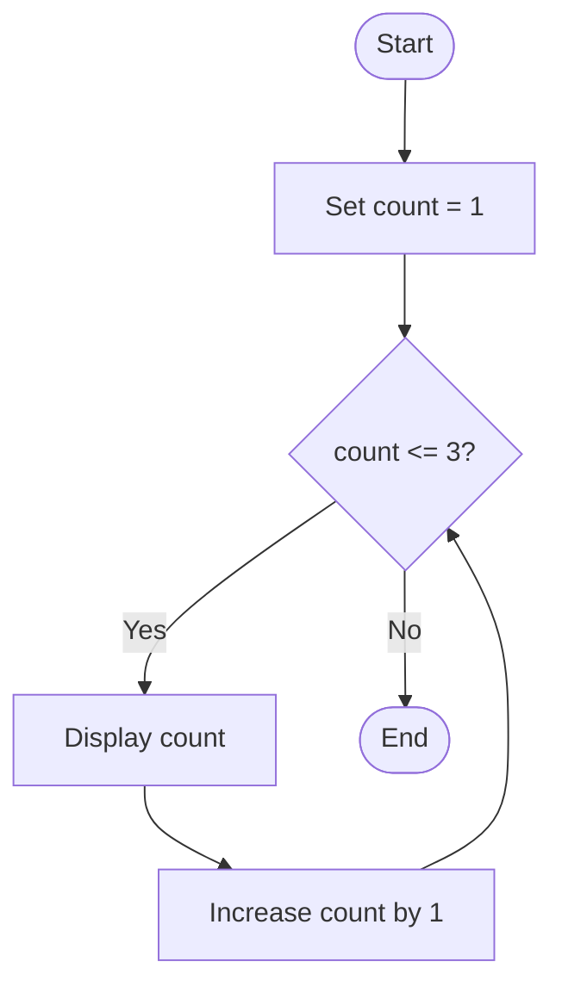
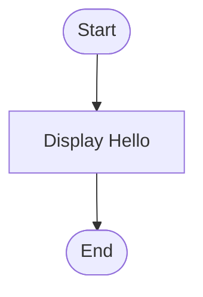
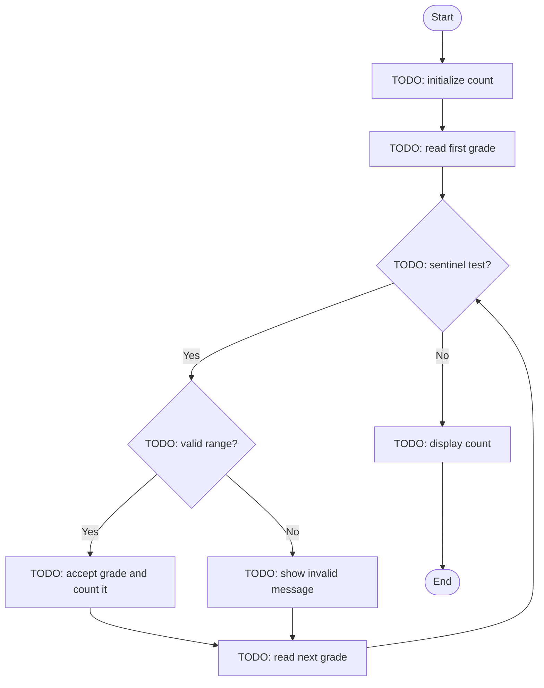
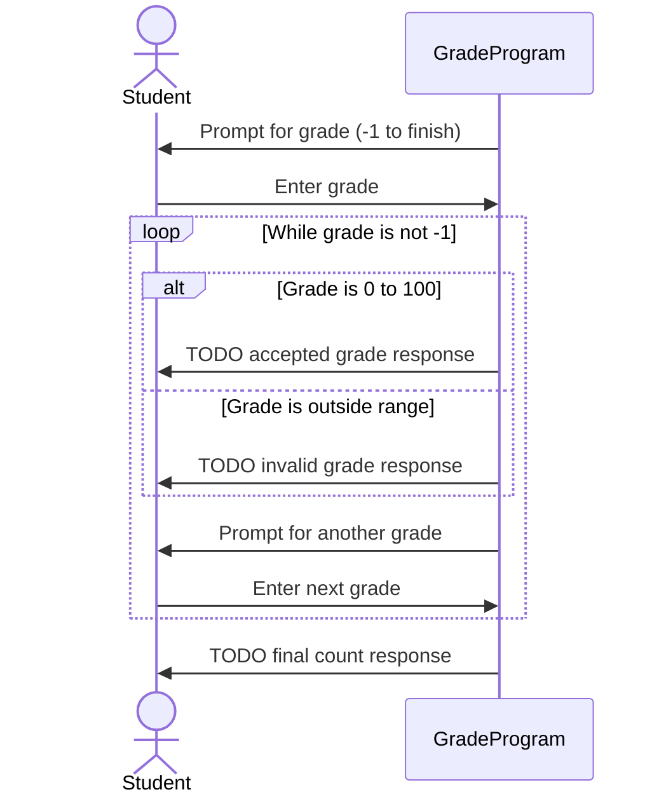

# PROG 1700 — Logic and Programming

# Workshop 05-01 — Introduction to Loops and Visualizing Program Behaviour with Mermaid

## 1. Workshop Details

| Field | Details |
|---|---|
| Course | PROG 1700 — Logic and Programming |
| Instructor | Davis Boudreau |
| Series | Workshop 05 — Loops and Iteration (Part 1 of 4) |
| Suggested time | 120 minutes (extend as needed for first-time Mermaid users) |
| Format | Self-guided, hands-on workshop; instructor facilitates and joins the activities |
| Tools | Python 3, VS Code, Markdown preview, Mermaid Live Editor (optional), Git/GitHub |
| Workshop folder | `sa-itos-ws05-01-introduction-to-loops-and-mermaid/` |
| Required evidence | Python exercise files, two Mermaid diagrams in Markdown, completed worksheet, Git commits |

## 2. Overview

### Purpose and use case

A student services team needs a simple program that repeatedly asks for course grades, calculates a class average, and reports how many grades were entered. A one-time `if` statement cannot process an unknown number of grades on its own. **Loops** allow a program to repeat steps until a stopping condition is met.

In this workshop, you will first explore how loops work, then build a small **Student Grade Processor**. You will also create **two diagrams using Mermaid**: a **flowchart** showing decisions and repetition, and a **sequence diagram** showing the interaction between the student and the program. The diagrams are part of the learning process, not decorations.

### Learning objectives

By the end, you should be able to:

1. Explain the purpose of `while` loops and the roles of a condition, counter, and accumulator.
2. Trace a loop and predict its output before running it.
3. Identify and correct common loop errors, including infinite loops and off-by-one mistakes.
4. Implement a grade-entry loop with a sentinel value and basic numeric range validation.
5. **Create, preview, and revise a Mermaid flowchart and sequence diagram** representing actual Python behaviour.
6. Record predictions, test results, debugging findings, and reflections in the workshop worksheet.

### Learning outcomes addressed

- **LO6 (primary):** Design and implement loops to perform repetitive tasks.
- **LO1:** Translate logic into code.
- **LO2:** Perform input/output operations.
- **LO4:** Use conditional logic to control behaviour.
- **LO7:** Debug using an IDE.

## 3. Prior Knowledge Check (5 minutes)

In your worksheet, answer briefly:

1. What is the difference between `=` and `==` in Python?
2. What does `if grade >= 50:` mean?
3. What happens if a condition remains `True` forever?
4. Where have you already seen a `while` loop in the Number Guessing Game from WS04?

If unsure, revisit the examples from WS03 and WS04. You do not need to submit separate answers beyond your worksheet.

## 4. Concepts and Theory (10 minutes)

A **loop** repeats a block of code. A `while` loop checks its condition **before each iteration**. When the condition is `False`, execution continues after the loop.

| Term | Meaning | Example |
|---|---|---|
| Condition | Determines whether to repeat | `count < 3` |
| Iteration | One complete pass through a loop | Printing one number |
| Counter | Tracks how many times something happens | `count += 1` |
| Accumulator | Builds a running result | `total += grade` |
| Sentinel | Special input that ends repetition | `-1` means finish |
| Infinite loop | A loop whose exit condition is never reached | Forgetting to change `count` |

### Reference pseudocode — counter-controlled loop

```text
START
SET count TO 1
WHILE count <= 3 DO
    DISPLAY count
    SET count TO count + 1
ENDWHILE
END
```

### Reference flowchart — a loop



**Observe:** The arrow from “Increase count” back to the decision is what makes the process repeat.

## 5. Tooling: Create and Preview Mermaid Diagrams (15 minutes)

Mermaid is a text-based diagram language. You type diagram instructions in a Markdown file, then preview the rendered diagram.

### A. Set up your workspace

1. Open **VS Code**.
2. Open your PROG 1700 Git repository using **File → Open Folder**.
3. Create a new folder named `sa-itos-ws05-01-introduction-to-loops-and-mermaid`.
4. Inside it, create `diagrams.md` and `workshop_worksheet.md`.
5. Open `diagrams.md`. Paste the following exactly, including the three backticks and the word `mermaid`:

````markdown
# My Workshop 05 Diagrams

## First Flowchart


````

6. Save with **Ctrl+S**.
7. Open Markdown preview with **Ctrl+Shift+V** (or Command Palette → **Markdown: Open Preview**). For side-by-side preview, use **Ctrl+K**, then **V**.
8. Confirm you see three connected shapes. If the preview displays only code or reports an error, check the backticks, indentation, and `mermaid` label. VS Code versions/extensions can differ; if Mermaid rendering is unavailable, paste **only the diagram source** (starting at `flowchart TD`) into <https://mermaid.live/> and view the preview there.
9. **Do not paste passwords, personal records, or private student data** into an online editor. Our diagrams use only sample program logic.

### B. Understand the syntax

| Mermaid text | Meaning |
|---|---|
| `flowchart TD` | Draw a flowchart from top to bottom |
| `A[Action]` | Rectangle for a processing step |
| `B{Question?}` | Diamond for a decision |
| `C([Start or End])` | Rounded start/end node |
| `A --> B` | Connect A to B |
| `B -- Yes --> C` | Label an arrow Yes |
| `sequenceDiagram` | Start a sequence diagram |
| `actor Student` | Show a person interacting with the program |
| `participant Program` | Show the software as a participant |
| `Student->>Program: Enter grade` | Show a message or interaction |
| `loop While entering grades` | Group repeated interactions |
| `alt Valid grade` / `else Invalid grade` | Show alternative paths |

**Checkpoint:** In `diagrams.md`, change `Display Hello` to `Display Welcome`, save, and confirm the preview changes. Record whether you used VS Code preview or Mermaid Live Editor in your worksheet.

## 6. Activity 1 — Investigate a Counter-Controlled Loop (15 minutes)

**File:** `counting_loop.py`

1. In the workshop folder, create `counting_loop.py`.
2. **Predict** the exact output in your worksheet before running the code.
3. Enter the code:

```python
count = 1

while count <= 3:
    print("Iteration:", count)
    count += 1

print("Loop finished.")
```

4. Save (**Ctrl+S**).
5. Open **Terminal → New Terminal** in VS Code. Ensure the terminal is in your workshop folder (use `cd sa-itos-ws05-01-introduction-to-loops-and-mermaid` if needed).
6. Run `python counting_loop.py` (on systems where `python` is unavailable, try `python3 counting_loop.py` or `py counting_loop.py`).
7. Compare your prediction with the actual output:

```text
Iteration: 1
Iteration: 2
Iteration: 3
Loop finished.
```

8. Change `count <= 3` to `count < 3`. Predict and run again. What changed?
9. Restore `count <= 3` and run again.

### Trace the loop

Complete the missing cells in your worksheet:

| Check | `count` before test | `count <= 3` | Action |
|---|---:|---|---|
| 1 | 1 | True | Print 1; increment |
| 2 | 2 | ? | ? |
| 3 | 3 | ? | ? |
| 4 | 4 | ? | ? |

**Checkpoint:** Explain why the loop prints three times, not four.

## 7. Activity 2 — Debug a Loop That Does Not Stop (15 minutes)

**File:** `loop_debugging.py`

1. Create `loop_debugging.py` and paste:

```python
count = 1

while count <= 3:
    print("Count:", count)

print("Done")
```

2. **Before running**, identify the missing step in your worksheet.
3. Run the program and observe the repeated output briefly. **Stop it immediately with Ctrl+C** in the terminal. Do not leave it running.
4. Explain why the condition never becomes `False`.
5. Correct the code by adding `count += 1` **inside** the loop, save, and rerun.
6. Set a VS Code breakpoint beside `while count <= 3:`. Choose **Run → Start Debugging**, selecting **Python File** if prompted. If the Python debugger is unavailable, install/enable the Microsoft Python extension or trace using printed values.
7. Use **Step Over (F10)** to observe how `count` changes. Record its value before each condition check.

**Checkpoint:** The corrected program must terminate and print `Done` once.

## 8. Activity 3 — Build a Grade-Entry Loop (20 minutes)

**File:** `grade_entry.py`

A sentinel value is a special input that tells a loop to stop. Here, `-1` means **finish entering grades**; it is not a grade and must not be included in calculations.

### Step A — Predict

In your worksheet, predict what happens when the user enters `80`, `90`, then `-1`.

### Step B — Build

Create `grade_entry.py`:

```python
count = 0

grade = int(input("Enter a grade (0-100), or -1 to finish: "))

while grade != -1:
    if 0 <= grade <= 100:
        print("Accepted grade:", grade)
        count += 1
    else:
        print("Invalid grade. Enter 0 to 100, or -1 to finish.")

    grade = int(input("Enter a grade (0-100), or -1 to finish: "))

print("Number of accepted grades:", count)
```

### Step C — Save, run, and test

Run `python grade_entry.py`. Test these input sequences **one run at a time**:

| Inputs | Expected result |
|---|---|
| `80`, `90`, `-1` | 2 accepted grades |
| `-1` | 0 accepted grades |
| `0`, `100`, `-1` | 2 accepted grades |
| `101`, `-5`, `75`, `-1` | Invalid messages for 101 and -5; 1 accepted grade |

**Important:** At this stage, entering text such as `hello` raises `ValueError` because `int()` cannot convert it. That is an exception-handling topic from WS04. You may apply your WS04 `try/except` skills as an optional improvement, but the required focus here is understanding loop behaviour.

### Step D — Inspect

In your worksheet, answer: Why is the second `input()` statement **inside** the loop? What happens if you accidentally move it outside?

## 9. Activity 4 — Create Your Own Mermaid Flowchart (15 minutes)

**Deliverable:** A new `## Grade Entry Flowchart` section in `diagrams.md`.

1. Open `diagrams.md`.
2. Add a heading `## Grade Entry Flowchart`.
3. Copy this **starter** and replace each `TODO` label with the real action or decision from `grade_entry.py`:

````markdown
## Grade Entry Flowchart


````

4. Save and preview the diagram. Verify that **both** the valid and invalid paths return to the next input, and that entering `-1` exits the loop.
5. Run `grade_entry.py` with `101`, `75`, `-1` while following the corresponding arrows on your diagram.
6. Correct any mismatch between the diagram and the code. **The diagram must represent what the program actually does.**

**Checkpoint:** Your flowchart includes a start, end, decision for `-1`, decision for valid grade range, and an arrow that loops back.

## 10. Activity 5 — Create Your Own Mermaid Sequence Diagram (15 minutes)

**Deliverable:** A new `## Grade Entry Sequence Diagram` section in `diagrams.md`.

A **flowchart** shows decisions and control flow. A **sequence diagram** shows **who communicates with whom, and in what order**. Here, the participants are `Student` and `GradeProgram`.

1. Add this starter to `diagrams.md`:

````markdown
## Grade Entry Sequence Diagram


````

2. Replace each `TODO` with the correct message from your Python program.
3. Preview the sequence diagram. Identify where repetition begins and ends.
4. Trace the input sequence `101`, `75`, `-1` against the diagram. Describe the order of interactions in your worksheet.
5. Add a brief Markdown paragraph under the diagram: **“A flowchart emphasizes ___; a sequence diagram emphasizes ___.”** Fill in both blanks.

**Checkpoint:** Both diagrams render correctly, and the loop/alternative blocks correspond to the Python code.

## 11. Activity 6 — Independent Challenge: Grade Average (15–20 minutes)

**File:** `grade_average.py`

Extend your Grade Entry program to calculate an average of **accepted grades only**.

### Requirements

1. Create `grade_average.py` by copying your working `grade_entry.py`.
2. Add `total = 0` before the loop.
3. When a valid grade is accepted, add it to `total` using `total += grade`.
4. After the loop, if `count > 0`, calculate `average = total / count` and display the result to **two decimal places** (for example, `print(f"Average: {average:.2f}")`).
5. If no grades were accepted, display `No grades entered.` rather than dividing by zero.
6. **Update your Mermaid flowchart** to show the accumulator update and the final `count > 0` decision.
7. **Update your sequence diagram** to show the final average (or no-grades message).

### Verification tests

| Inputs | Expected final result |
|---|---|
| `80`, `90`, `-1` | Count 2; average 85.00 |
| `0`, `100`, `-1` | Count 2; average 50.00 |
| `101`, `70`, `-1` | Count 1; average 70.00 |
| `-1` | No grades entered; no crash |

**Challenge extension (optional):** Add a `passing_count` counter for grades of 50 or more. Test the new counter and update both diagrams to reflect the added logic.

## 12. Checkpoints and Verification

Before marking the workshop complete, verify:

- [ ] `counting_loop.py` prints the expected values and terminates.
- [ ] `loop_debugging.py` no longer runs indefinitely.
- [ ] `grade_entry.py` rejects out-of-range numeric grades and stops on `-1`.
- [ ] `grade_average.py` calculates correct averages and handles zero accepted grades.
- [ ] `diagrams.md` contains **a student-created flowchart and sequence diagram** that render and match the final code.
- [ ] The worksheet records predictions, trace results, test cases, a debugging investigation, and reflection.
- [ ] Python and Markdown files are saved and committed/pushed to GitHub.

## 13. Reflection Questions

Record responses in `workshop_worksheet.md`:

1. How does a `while` loop differ from an `if` statement?
2. What caused the infinite loop, and how did you fix it?
3. Why must `-1` be excluded from the grade count and total?
4. Which diagram helped you understand the program better: the flowchart or sequence diagram? Give one specific example.
5. What did you change in a diagram after testing your Python program?
6. What would happen if you tried to calculate an average when `count` is zero?

## 14. Student Deliverables & Submission Guidelines

All students are required to complete the **Workshop Worksheet** as they work through the activities. The worksheet is an important part of the learning process and should document predictions, observations, test results, debugging findings, and reflections.

**In-Class Students:** Students attending the scheduled workshop must complete the worksheet while working through the activities. At the end of the workshop, the instructor will facilitate a class review to discuss findings, solutions, and key learning concepts. **Worksheet submission is not required** for students attending in class unless otherwise directed.

**Absent Students:** Students who miss the scheduled workshop must complete all activities independently, including the entire worksheet, and **submit the completed worksheet to Brightspace** as evidence of their learning.

All students must complete the required programming exercises and commit/push their technical work to GitHub, where applicable.

### Files to retain in the GitHub workshop folder

```text
sa-itos-ws05-01-introduction-to-loops-and-mermaid/
├── counting_loop.py
├── loop_debugging.py
├── grade_entry.py
├── grade_average.py
├── diagrams.md
└── workshop_worksheet.md
```

**Git steps:** Open Source Control in VS Code, review changed files, stage them, commit with a meaningful message such as `Complete WS05-01 loops and Mermaid diagrams`, then push/sync to GitHub. Confirm the files appear in the remote repository. Absent students submit their completed worksheet to Brightspace; the GitHub work remains technical evidence for everyone.

## 15. Evaluation Criteria — A/P/T/F/R

| Criterion | Evidence |
|---|---|
| **A — Attendance** | In-class attendance or documented independent completion, as applicable |
| **P — Participation** | Active engagement with exercises, testing, diagrams, and review |
| **T — Task Progress** | Working Python files, trace/testing evidence, and **both Mermaid diagrams** |
| **F — Focus & Professional Conduct** | Productive, responsible troubleshooting and appropriate collaboration |
| **R — Reflection** | Completed worksheet and thoughtful explanation of findings |

## 16. Completion and Exit Evidence

You should be able to demonstrate **one complete run** of `grade_average.py` and explain the matching route through your flowchart and the matching messages in your sequence diagram. Be ready to describe one bug you discovered and how you verified the fix.

### Looking ahead

- **WS05-02:** `for` loops, `range()`, and iterating over sequences.
- **WS05-03:** Loop control, nested loops, and tracing complex repetition.
- **WS05-04:** Applied loops, integration, testing, and refinement.

In each upcoming workshop, students will continue creating and revising Mermaid diagrams to visualize program logic and interactions.
