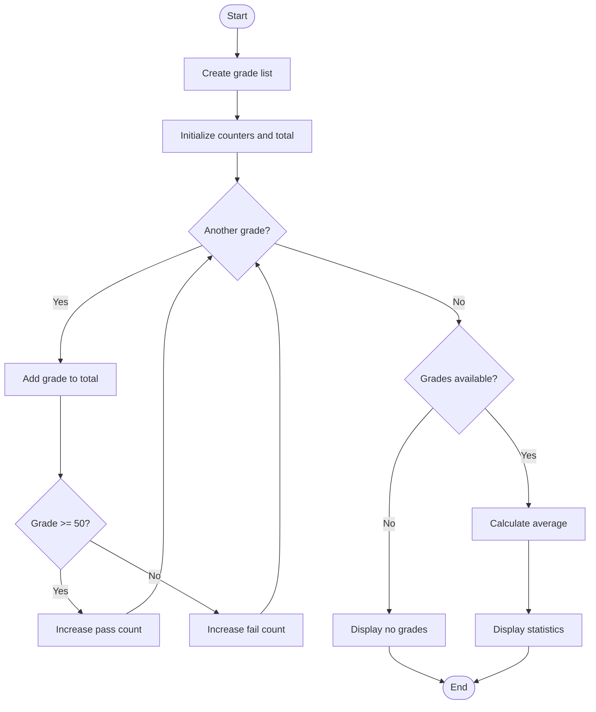
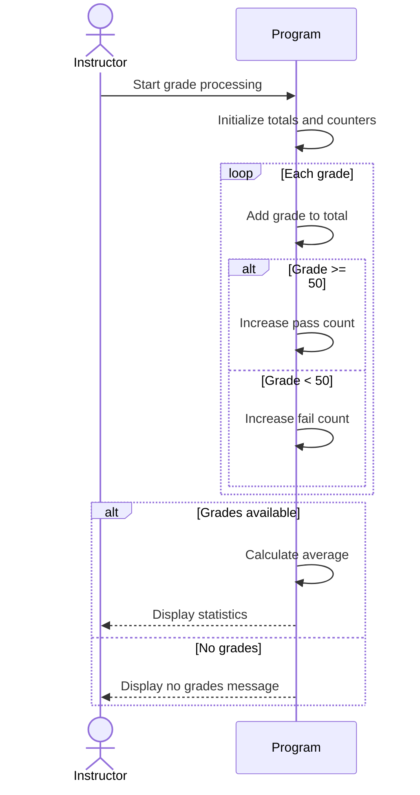

# PROG 1700 — Logic and Programming
# Workshop 05-03 — Iterating Through Strings and Lists

**Workshop Series 05: Loops, Iteration and Data Structures**  
**Part 3 of 7 — Integrated Tutorial and Practical Workshop**

---

## 1. Workshop Details

| Field | Details |
|---|---|
| **Course** | PROG 1700 — Logic and Programming |
| **Instructor** | Davis Boudreau |
| **Workshop** | WS05-03 — Iterating Through Strings and Lists |
| **Estimated Time** | 180–240 minutes, approximately two instructional sessions |
| **Delivery** | Self-guided, instructor-facilitated |
| **Tools** | Python 3, VS Code, Git, GitHub, Mermaid |
| **Workshop Filename** | `sa-itos-ws05-03-iterating-through-strings-and-lists.md` |
| **Exercise Folder** | `ws05-03-iterating-through-strings-and-lists` |

---

## 2. Workshop Overview

### 2.1 Purpose

Computer programs frequently need to manage collections of related information.

Consider a college application that manages:

- Student names.
- Course registrations.
- Assessment grades.
- Attendance records.
- Student identifiers.

A program could store every value in a separate variable. However, this becomes difficult to manage as the amount of information increases.

**Data structures** provide an organized way to store, access, process, and manipulate information.

In this workshop, you will investigate two Python data structures:

1. **Strings (`str`)** — ordered sequences of characters.
2. **Lists (`list`)** — ordered, changeable collections of values.

You will learn how these structures work, how to select and use them, and how to perform **Create, Read, Update, and Delete (CRUD)** operations.

You will also use the `for` loops introduced in WS05-02 to process strings and lists.

### 2.2 Real-World Scenario

An instructor needs a small application for managing a student roster and assessment grades.

The application must allow the instructor to:

- Add student names.
- Display existing students.
- Correct student names.
- Remove students.
- Add assessment grades.
- Display grades.
- Correct grades.
- Remove grades.
- Calculate grade statistics.

You will begin by understanding the underlying data structures and gradually develop the programming skills required to build this application.

### 2.3 Learning Objectives

By the end of this workshop, you should be able to:

1. Explain what a data structure is and why programmers use data structures.
2. Distinguish between variables, data types, and data structures.
3. Identify common Python collection types.
4. Explain sequences, indexing, slicing, and iteration.
5. Describe mutable and immutable data structures.
6. Create, read, update, and delete string data appropriately.
7. Create, read, update, and delete list data.
8. Use string methods to clean, search, and transform text.
9. Use list methods to manage collections.
10. Iterate through strings and lists using `for` loops.
11. Apply counters, accumulators, and conditional logic to collections.
12. Identify and correct common indexing and mutation errors.
13. Use the VS Code debugger to observe collection processing.
14. Create Mermaid flowcharts and sequence diagrams.
15. Develop and test a menu-driven Student Roster and Grade List Manager.

### 2.4 Learning Outcomes

**Primary**

- **LO3 — Data Structures:** Store, organize, access, and manipulate data using appropriate structures.
- **LO6 — Loops:** Implement repetition to process collections.

**Supporting**

- LO1 — Programming logic.
- LO2 — Input and output.
- LO4 — Conditional logic.
- LO7 — Debugging and testing.

---

# 3. Tutorial — Understanding Data Structures

## 3.1 What Is a Data Structure?

A **data structure** is a way of organizing and storing information so that a computer program can work with it effectively.

Data structures help programmers:

- Group related information.
- Retrieve information.
- Modify existing information.
- Add new information.
- Remove unwanted information.
- Search collections.
- Process multiple values using loops.

### Example: Storing Assessment Grades

Suppose an instructor records three assessment grades.

One approach is to use separate variables:

```python
grade1 = 80
grade2 = 90
grade3 = 70

total = grade1 + grade2 + grade3
average = total / 3

print("Average:", average)
```

This works for three grades.

However, consider what happens when the instructor must manage 30 grades.

Would you create 30 separate variables?

What happens if another grade is added?

What if the instructor needs to find the highest grade?

What if one grade must be removed?

These requirements become increasingly difficult when every value is managed separately.

### A Better Approach: Collections

Python provides a data structure called a **list**.

```python
grades = [80, 90, 70]
```

Instead of creating three separate variables, the program stores the values together.

A loop can process every grade:

```python
grades = [80, 90, 70]

total = 0

for grade in grades:
    total += grade

average = total / len(grades)

print("Average:", average)
```

Expected output:

```text
Average: 80.0
```

The same logic can process three grades or hundreds of grades without adding a new variable for every value.

### Why This Matters

Data structures separate the information being stored from the logic used to process it.

A program can often process a larger collection simply by adding more values to the data structure.

This is one reason data structures are fundamental to software development.

### Knowledge Check

Answer in your worksheet:

1. What problem arises when a program uses hundreds of separate variables?
2. How does a list help organize related information?
3. Why is a loop useful when processing a collection?
4. What happens to the loop when another grade is added?

---

## 3.2 Variables, Data Types, and Data Structures

These concepts are related, but they are not identical.

### Variables

A variable is a name that refers to a value or object.

```python
student_name = "Alex"
```

Here, `student_name` refers to the string `"Alex"`.

### Data Types

A data type describes the kind of value and the operations supported by that value.

Common Python types include:

```python
age = 20                 # int
average = 85.5           # float
is_enrolled = True       # bool
student_name = "Alex"    # str
```

Python also provides collection types.

### Data Structures

A data structure organizes values and defines how those values can be accessed and manipulated.

For example:

```python
grades = [80, 90, 70]
```

The variable `grades` refers to a list containing three integers.

The list is one object, but it organizes multiple values.

### Inspecting Types

Python provides the built-in `type()` function.

```python
student_name = "Alex"
grades = [80, 90, 70]

print(type(student_name))
print(type(grades))
```

Expected output:

```text
<class 'str'>
<class 'list'>
```

### Key Distinction

A variable is a name.

A data type describes a value.

A data structure organizes information.

---

## 3.3 Python's Common Data Structures

Python includes several built-in collection types.

| Structure | Example | Characteristics |
|---|---|---|
| String | `"Alex"` | Ordered, immutable text sequence |
| List | `[80, 90, 70]` | Ordered, mutable collection |
| Tuple | `(80, 90, 70)` | Ordered, immutable collection |
| Set | `{80, 90, 70}` | Collection of unique values |
| Dictionary | `{"Alex": 85}` | Key-value collection |

You will study strings and lists in this workshop.

Tuples, sets, and dictionaries will be introduced in subsequent workshops.

### Selecting the Right Structure

A programmer should consider:

- Does the order of values matter?
- Will the values change?
- Are duplicates allowed?
- Do values need to be accessed by position?
- Should values be associated with identifiers?

For example:

- A student name is naturally represented as a string.
- A collection of grades can be represented as a list.
- A fixed group of values might be represented as a tuple.
- Unique identifiers may be represented using a set.
- Student identifiers associated with records may be represented using a dictionary.

### Knowledge Check

Why would a list be more appropriate than a string for storing multiple numeric grades?

---

## 3.4 Understanding CRUD

CRUD represents four fundamental operations used to manage information.

| Operation | Meaning | Student Records Example |
|---|---|---|
| **Create** | Add new information | Add a student |
| **Read** | Retrieve information | Display a student |
| **Update** | Modify information | Correct a student name |
| **Delete** | Remove information | Remove a student |

CRUD is not exclusive to databases.

The same operations appear in:

- Lists.
- Dictionaries.
- Files.
- Databases.
- Web applications.
- Business software.

### Important Concept

Not every data structure supports CRUD in the same way.

For example, Python lists can be modified directly.

Python strings cannot.

This introduces the distinction between **mutability** and **immutability**.

---

# 4. Tutorial — Understanding Strings

## 4.1 What Is a String?

A string is an ordered sequence of characters.

Strings are commonly used to represent:

- Names.
- Messages.
- Addresses.
- Course codes.
- Student identifiers.
- File paths.
- User input.

Example:

```python
student_name = "Alexander"
```

The string contains nine characters.

Python treats each character as part of an ordered sequence.

```text
Character:   A  l  e  x  a  n  d  e  r
Index:       0  1  2  3  4  5  6  7  8
```

Each character has a position called an **index**.

## 4.2 Zero-Based Indexing

Python begins indexing at zero.

```python
name = "Alex"

print(name[0])
print(name[1])
print(name[2])
print(name[3])
```

Expected output:

```text
A
l
e
x
```

The first character is at index 0.

### Negative Indexing

Python also supports negative indexes.

```python
name = "Alex"

print(name[-1])
print(name[-2])
```

Expected output:

```text
x
e
```

Negative indexing counts backward from the end.

### Common Error: Invalid Index

```python
name = "Alex"

print(name[10])
```

This produces an `IndexError`.

The string contains only four characters, so index 10 does not exist.

### Tutorial Checkpoint

Predict:

```python
course = "PROG1700"

print(course[0])
print(course[4])
print(course[-1])
```

Record your answers before running the code.

---

## 4.3 String Length

The built-in `len()` function returns the number of characters in a string.

```python
name = "Alexander"

print(len(name))
```

Expected output:

```text
9
```

Spaces and punctuation are also characters.

```python
name = "Alex Smith"

print(len(name))
```

Expected output:

```text
10
```

The space between the names counts as one character.

---

## 4.4 String Slicing

Slicing retrieves part of a sequence.

General syntax:

```python
string[start:stop]
```

The start index is included.

The stop index is excluded.

Example:

```python
name = "Alexander"

print(name[0:4])
print(name[:4])
print(name[4:])
```

Expected output:

```text
Alex
Alex
ander
```

### Slicing with a Step

Python also supports:

```python
string[start:stop:step]
```

Example:

```python
name = "Alexander"

print(name[::2])
```

Expected output:

```text
Aeade
```

The slice selects every second character.

### Knowledge Check

What does this expression return?

```python
name = "Programming"

print(name[0:7])
```

---

## 4.5 String Immutability

Strings are **immutable**.

This means their characters cannot be changed directly after the string has been created.

Consider:

```python
name = "Alex"

name[0] = "J"
```

Python raises:

```text
TypeError: 'str' object does not support item assignment
```

Why?

Because individual string characters cannot be replaced in place.

Instead, the program must create a new string.

```python
name = "Alex"

name = "J" + name[1:]

print(name)
```

Expected output:

```text
Jlex
```

The expression constructs a new string and assigns it to `name`.

### Important Distinction

The variable can refer to a different string.

The original string object is not modified.

This distinction becomes important when performing string CRUD operations.

---

# 5. Activity 1 — String Exploration and Iteration

**File:** `string_explorer.py`

### Learning Goal

Explore how strings store characters and how loops process them.

### Step 1 — Prepare the Workspace

1. Open VS Code.
2. Open your PROG 1700 repository.
3. Create the folder:

   `ws05-03-iterating-through-strings-and-lists`

4. Create `string_explorer.py`.
5. Open the integrated terminal.

### Step 2 — Predict

Consider:

```python
name = "Alexander"

for character in name:
    print(character)
```

Before running:

- How many times will the loop execute?
- What is the first character displayed?
- What is the last character displayed?
- Does the loop require an explicit counter?

### Step 3 — Implement

```python
student_name = "Alexander"

print("Student:", student_name)
print("Length:", len(student_name))

print("\nCharacters:")

for character in student_name:
    print(character)
```

Run:

```bash
python string_explorer.py
```

Use `python3` if your environment requires it.

### Step 4 — Iterate by Index

Add:

```python
print("\nCharacter positions:")

for index in range(len(student_name)):
    print(index, student_name[index])
```

### Understanding the Difference

There are two common approaches to iterating through a string.

**Iteration by value:**

```python
for character in student_name:
    print(character)
```

This is appropriate when you need the characters.

**Iteration by index:**

```python
for index in range(len(student_name)):
    print(index, student_name[index])
```

This is useful when the position of each character matters.

### Step 5 — Debug

1. Place a breakpoint on `print(index, student_name[index])`.
2. Press `F5` to begin debugging.
3. Inspect `index` and `student_name` in the Variables pane.
4. Press `F10` to execute the highlighted statement.
5. Continue stepping through the loop.
6. Observe how `index` changes.

**Remember:** The highlighted statement is the next statement Python will execute.

### Step 6 — Experiment

Change the name to:

- `"Alex"`
- `"Jordan"`
- `"Taylor Smith"`

Run the program after each change.

### Checkpoint

Explain when you would iterate through a string by value and when you would iterate by index.

---

# 6. Tutorial — CRUD Operations on Strings

## 6.1 Create

Creating a string means constructing a string value.

```python
name = "Alex"
```

Strings can also be created from input.

```python
name = input("Enter student name: ")
```

Strings can be combined using concatenation.

```python
first_name = "Alex"
last_name = "Smith"

full_name = first_name + " " + last_name

print(full_name)
```

Expected output:

```text
Alex Smith
```

## 6.2 Read

Reading string data includes:

- Accessing characters.
- Extracting substrings.
- Searching for text.
- Iterating through characters.

```python
name = "Alexander"

print(name[0])
print(name[-1])
print(name[:4])
```

## 6.3 Update

Since strings are immutable, updating requires creating a new string.

```python
name = "Alexander"

name = "Alex"

print(name)
```

You can also construct a replacement from existing parts.

```python
name = "Alex"

name = "J" + name[1:]

print(name)
```

### Using String Methods

Python provides methods that return transformed strings.

```python
name = "  alex smith  "

name = name.strip()
name = name.title()

print(name)
```

Expected output:

```text
Alex Smith
```

Common string methods:

| Method | Purpose |
|---|---|
| `strip()` | Remove surrounding whitespace |
| `lower()` | Convert to lowercase |
| `upper()` | Convert to uppercase |
| `title()` | Apply title capitalization |
| `replace()` | Return a string with replacements |
| `find()` | Find a substring position |
| `count()` | Count occurrences |

These methods return results rather than changing the original string object in place.

## 6.4 Delete

Deleting part of a string means constructing a new string that excludes unwanted characters.

Example:

```python
name = "Alexander"

name = name[:4] + name[5:]

print(name)
```

Expected output:

```text
Alexnder
```

The character at index 4 has been excluded.

### Removing a Substring

```python
message = "Student: Alex"

message = message.replace("Student: ", "")

print(message)
```

Expected output:

```text
Alex
```

### Removing Whitespace

```python
name = "  Alex  "

name = name.strip()

print(name)
```

Expected output:

```text
Alex
```

### CRUD Summary — Strings

| CRUD | Technique |
|---|---|
| Create | String literals, `input()`, concatenation |
| Read | Indexing, slicing, iteration |
| Update | Construct a replacement string |
| Delete | Construct a string without unwanted content |

---

# 7. Activity 2 — Student Name Editor

**File:** `student_name_editor.py`

### Scenario

A student record contains a name entered with inconsistent capitalization and unnecessary whitespace.

The program must clean and modify the name.

### Step 1 — Create

```python
student_name = "  jordan smith  "

print("Original:", repr(student_name))
```

The `repr()` function displays a representation of the string that makes surrounding spaces easier to notice.

### Step 2 — Read

```python
print("Length:", len(student_name))
print("First character:", repr(student_name[0]))
```

### Step 3 — Update

```python
student_name = student_name.strip()
student_name = student_name.title()

print("Cleaned:", student_name)
```

Expected output:

```text
Cleaned: Jordan Smith
```

### Step 4 — Delete

Remove the space between the first and last names.

```python
student_name = student_name.replace(" ", "")

print("Without spaces:", student_name)
```

Expected output:

```text
Without spaces: JordanSmith
```

### Step 5 — Independent Challenge

Create a program that:

1. Requests a student name.
2. Removes surrounding whitespace.
3. Converts the name to title capitalization.
4. Displays the first character.
5. Displays the last character.
6. Displays the number of characters.
7. Removes all spaces from the name.
8. Displays the final string.

Handle empty input before accessing characters.

### Step 6 — Debug

Set a breakpoint before the first `strip()` operation.

Observe how the value changes after each assignment.

### Checkpoint

Demonstrate Create, Read, Update, and Delete operations on strings.

Explain why the program creates replacement strings.

---

# 8. Activity 3 — String Searching and Character Counting

**File:** `string_analyzer.py`

## Tutorial — Membership Testing

The `in` operator checks whether a value appears in a sequence.

```python
name = "Alexander"

print("Alex" in name)
print("Jordan" in name)
```

Expected output:

```text
True
False
```

Membership testing is useful for searching and validation.

## Tutorial — Counters

A counter tracks how many times an event occurs.

```python
name = "Alexander"

count = 0

for character in name.lower():
    if character == "a":
        count += 1

print("Occurrences:", count)
```

Expected output:

```text
Occurrences: 2
```

## Guided Exercise — Vowel Counter

Create:

```python
sentence = input("Enter a sentence: ")

vowels = "aeiou"
vowel_count = 0

for character in sentence.lower():
    if character in vowels:
        vowel_count += 1

print("Vowels:", vowel_count)
```

### Predict

For the input:

```text
Hello World
```

How many vowels should the program count?

### Run and Verify

Expected output:

```text
Vowels: 3
```

### Independent Challenge

Extend the program to count:

- Vowels.
- Consonants.
- Spaces.

Use `isalpha()` to identify letters before counting consonants.

### Checkpoint

Explain how membership testing, loops, and counters work together.

---

# 9. Tutorial — Understanding Lists

## 9.1 What Is a List?

A list is an ordered, mutable collection of values.

Example:

```python
grades = [80, 90, 70]
```

Unlike a string, which stores a sequence of characters, a list can store multiple values as separate elements.

Each element has an index.

```text
Index:     0    1    2
Value:    80   90   70
```

### Why Lists Are Useful

Lists are useful when:

- Multiple values belong together.
- The number of values may change.
- Values must be processed using loops.
- Elements need to be added or removed.
- Existing elements need to be corrected.

Examples include:

```python
students = ["Alex", "Jordan", "Taylor"]

grades = [80, 90, 70]

courses = ["PROG1700", "WEBD1000", "DBAS3200"]
```

## 9.2 Lists Can Contain Different Types

Python permits lists containing different types.

```python
record = ["Alex", 20, True]
```

However, storing related values of consistent types often makes beginner programs easier to understand and maintain.

For this workshop, use separate lists of student names and numeric grades.

Later workshops will introduce better ways to represent structured student records.

---

## 9.3 Lists Are Mutable

A mutable object can be changed after it is created.

```python
grades = [80, 90, 70]

grades[0] = 85

print(grades)
```

Expected output:

```text
[85, 90, 70]
```

Unlike strings, lists support direct element assignment.

### Comparing Strings and Lists

```python
name = "Alex"
grades = [80, 90, 70]
```

This fails:

```python
name[0] = "J"
```

This succeeds:

```python
grades[0] = 85
```

The distinction is not about whether a variable can be reassigned.

It is about whether the object itself supports modification.

---

## 9.4 List Indexing and Slicing

Lists use zero-based indexing.

```python
grades = [80, 90, 70, 85]

print(grades[0])
print(grades[-1])
print(grades[1:3])
```

Expected output:

```text
80
85
[90, 70]
```

A list slice creates a new list containing the selected elements.

### Empty Lists

An empty list contains no elements.

```python
grades = []
```

Its length is zero.

```python
print(len(grades))
```

Expected output:

```text
0
```

Trying to access `grades[0]` on an empty list raises `IndexError`.

---

# 10. Activity 4 — List Exploration

**File:** `list_explorer.py`

### Step 1 — Create

```python
grades = [80, 90, 70, 85]

print("Grades:", grades)
print("Count:", len(grades))
```

### Step 2 — Read

```python
print("First:", grades[0])
print("Last:", grades[-1])
print("First two:", grades[:2])
```

### Step 3 — Iterate by Value

```python
for grade in grades:
    print("Grade:", grade)
```

### Step 4 — Iterate by Index

```python
for index in range(len(grades)):
    print("Index:", index, "Grade:", grades[index])
```

### Step 5 — Debug

Place a breakpoint inside the indexed loop.

Use `F5` and `F10`.

Inspect:

- `grades`
- `index`

Observe how the index selects an element.

### Step 6 — Experiment

Add another grade:

```python
grades.append(95)
```

Run the program again.

Does the loop require modification?

### Checkpoint

Explain why lists work naturally with `for` loops.

---

# 11. Tutorial — CRUD Operations on Lists

## 11.1 Create

Create a list:

```python
grades = [80, 90, 70]
```

Create an empty list:

```python
grades = []
```

Add an element:

```python
grades.append(85)
```

Insert at a specific position:

```python
grades.insert(1, 95)
```

### Understanding `append()`

`append()` adds one element to the end of the existing list.

```python
grades = [80, 90, 70]

grades.append(85)

print(grades)
```

Expected output:

```text
[80, 90, 70, 85]
```

### Understanding `insert()`

`insert(index, value)` adds an element at a specified position.

```python
grades = [80, 90, 70]

grades.insert(1, 95)

print(grades)
```

Expected output:

```text
[80, 95, 90, 70]
```

Existing elements shift to accommodate the new element.

---

## 11.2 Read

Read an individual element:

```python
print(grades[0])
```

Read all elements:

```python
for grade in grades:
    print(grade)
```

Check membership:

```python
if 90 in grades:
    print("Grade found.")
```

Retrieve the number of elements:

```python
print(len(grades))
```

---

## 11.3 Update

Lists allow direct updates.

```python
grades = [80, 90, 70]

grades[1] = 95

print(grades)
```

Expected output:

```text
[80, 95, 70]
```

### Updating Multiple Elements

A loop can update every element using its index.

```python
grades = [80, 90, 70]

for index in range(len(grades)):
    grades[index] += 5

print(grades)
```

Expected output:

```text
[85, 95, 75]
```

### Common Mistake

This code does not update the list:

```python
for grade in grades:
    grade += 5
```

The loop variable receives each element's value.

Reassigning the loop variable does not replace the corresponding list element.

To update the list, use indexes.

---

## 11.4 Delete

Python provides several ways to remove list elements.

### Remove by Value

```python
grades = [80, 90, 70]

grades.remove(90)

print(grades)
```

Expected output:

```text
[80, 70]
```

`remove()` deletes the first matching value.

If the value is missing, `ValueError` is raised.

### Remove by Index

```python
grades = [80, 90, 70]

removed = grades.pop(1)

print("Removed:", removed)
print("Remaining:", grades)
```

Expected output:

```text
Removed: 90
Remaining: [80, 70]
```

`pop()` removes and returns an element.

### Delete with `del`

```python
grades = [80, 90, 70]

del grades[0]

print(grades)
```

Expected output:

```text
[90, 70]
```

### Remove All Elements

```python
grades = [80, 90, 70]

grades.clear()

print(grades)
```

Expected output:

```text
[]
```

### List CRUD Reference

| Operation | Python Technique |
|---|---|
| Create list | `[]` |
| Add to end | `append()` |
| Insert element | `insert()` |
| Read element | `list[index]` |
| Read slice | `list[start:stop]` |
| Update element | `list[index] = value` |
| Remove by value | `remove()` |
| Remove by index | `pop()` |
| Delete by index | `del` |
| Remove everything | `clear()` |

---

# 12. Activity 5 — Complete List CRUD

**File:** `list_crud.py`

### Step 1 — Create

```python
grades = [65, 75, 85]

print("Original:", grades)
```

### Step 2 — Add

```python
grades.append(95)

grades.insert(1, 70)

print("After additions:", grades)
```

Expected output:

```text
[65, 70, 75, 85, 95]
```

### Step 3 — Read

```python
for index in range(len(grades)):
    print(index, grades[index])
```

### Step 4 — Update

```python
grades[0] = 68

print("After correction:", grades)
```

### Step 5 — Delete

```python
grades.remove(85)

removed = grades.pop()

print("Removed final grade:", removed)
print("Remaining:", grades)
```

Expected final list:

```text
[68, 70, 75]
```

### Step 6 — Independent Challenge

Create a list containing four student names.

Perform:

1. Add another student.
2. Display all students.
3. Correct the second student's name.
4. Remove a student by value.
5. Remove a student by index.
6. Display the final list.

### Step 7 — Debug

Set breakpoints before:

```python
grades.append(95)
```

```python
grades[0] = 68
```

```python
grades.remove(85)
```

Inspect the list before and after each operation.

### Checkpoint

Demonstrate all four CRUD operations on a list.

---

# 13. Tutorial — Processing Lists with Loops

Lists become especially useful when combined with loops.

Consider a list of grades:

```python
grades = [80, 45, 90, 30, 60]
```

An instructor may want to calculate:

- Total grades.
- Average grade.
- Number of passing grades.
- Number of failing grades.
- Highest grade.
- Lowest grade.

## 13.1 Accumulators

An accumulator stores a running total.

```python
total = 0

for grade in grades:
    total += grade
```

Each iteration adds the current grade to the total.

## 13.2 Counters

A counter tracks the number of times something occurs.

```python
pass_count = 0

for grade in grades:
    if grade >= 50:
        pass_count += 1
```

## 13.3 Calculating an Average

```python
average = total / len(grades)
```

However, an empty list causes division by zero.

A program should check the collection before dividing.

```python
if len(grades) > 0:
    average = total / len(grades)
else:
    print("No grades available.")
```

This is an example of defensive programming.

---

# 14. Activity 6 — Grade Statistics Processor

**File:** `grade_statistics.py`

### Step 1 — Implement

```python
grades = [80, 45, 90, 30, 60]

total = 0
pass_count = 0
fail_count = 0

for grade in grades:
    total += grade

    if grade >= 50:
        pass_count += 1
    else:
        fail_count += 1

print("Grades:", grades)
print("Total:", total)
print("Passing:", pass_count)
print("Failing:", fail_count)

if len(grades) > 0:
    average = total / len(grades)

    print("Average:", round(average, 2))
    print("Highest:", max(grades))
    print("Lowest:", min(grades))
else:
    print("No grades available.")
```

### Step 2 — Predict

Determine the expected:

- Total.
- Average.
- Passing count.
- Failing count.
- Highest grade.
- Lowest grade.

### Step 3 — Run and Verify

Expected results:

```text
Total: 305
Passing: 3
Failing: 2
Average: 61.0
Highest: 90
Lowest: 30
```

### Step 4 — Trace

Complete the following table:

| Iteration | Grade | Running Total | Pass Count | Fail Count |
|---|---:|---:|---:|---:|
| 1 | 80 | | | |
| 2 | 45 | | | |
| 3 | 90 | | | |
| 4 | 30 | | | |
| 5 | 60 | | | |

### Step 5 — Test an Empty List

Change:

```python
grades = []
```

Run the program.

Explain why the empty-list check is necessary.

### Step 6 — Independent Challenge

Add a counter for perfect scores.

A perfect score is 100.

Test with:

```python
grades = [100, 85, 100, 45, 75]
```

Expected perfect-score count:

```text
2
```

### Checkpoint

Demonstrate counters, accumulators, averages, and safe processing of empty lists.

---

# 15. Tutorial — List References, Copies, and Common Errors

## 15.1 Assignment Does Not Copy a List

Consider:

```python
grades = [80, 90, 70]

backup = grades

grades[0] = 100

print(backup)
```

Expected output:

```text
[100, 90, 70]
```

Why did `backup` change?

Because both variables refer to the same list object.

### Creating a Separate Copy

```python
grades = [80, 90, 70]

backup = grades.copy()

grades[0] = 100

print("Grades:", grades)
print("Backup:", backup)
```

Expected output:

```text
Grades: [100, 90, 70]
Backup: [80, 90, 70]
```

For this workshop's simple one-dimensional lists, `copy()` provides an independent list.

You will investigate nested collections later in WS05-06.

## 15.2 Common List Errors

| Error | Cause | Prevention |
|---|---|---|
| `IndexError` | Invalid index | Check bounds |
| `ValueError` | Removing missing value | Check membership |
| `TypeError` | Incorrect operation | Verify types |
| `ZeroDivisionError` | Average of empty list | Check length |
| Logical error | Updating loop variable instead of list | Use index assignment |

## 15.3 Modifying Lists During Iteration

Removing items from a list while iterating directly over it can produce unexpected results.

Example:

```python
numbers = [2, 2, 4, 6]

for number in numbers:
    if number == 2:
        numbers.remove(number)

print(numbers)
```

The result is:

```text
[2, 4, 6]
```

One `2` remains because removing elements changes the list while the loop is traversing it.

A safer approach is to construct a new list:

```python
numbers = [2, 2, 4, 6]

filtered = []

for number in numbers:
    if number != 2:
        filtered.append(number)

print(filtered)
```

Expected output:

```text
[4, 6]
```

### Knowledge Check

Why is building a new filtered list often safer than removing elements during iteration?

---

# 16. Activity 7 — Mermaid Visualization and Debugging

**Files:**

- `grade_processing_flowchart.md`
- `grade_processing_sequence.md`

## 16.1 Why Visualize Algorithms?

A program describes instructions using code.

A flowchart describes decisions and control flow visually.

A sequence diagram describes interactions and the order of operations.

These diagrams help programmers:

- Plan algorithms.
- Understand loops.
- Identify decisions.
- Trace program execution.
- Communicate program behaviour.
- Investigate logical errors.

## 16.2 Creating Mermaid Diagrams

Mermaid is a text-based diagramming language.

Create a Markdown file and place a Mermaid diagram inside a fenced code block.

In VS Code:

1. Create the `.md` file.
2. Enter the Mermaid code.
3. Save the file.
4. Press `Ctrl+Shift+V` to open Markdown Preview.
5. If Mermaid rendering is unavailable, use a compatible extension or the Mermaid Live Editor at https://mermaid.live.

When using Mermaid Live Editor, paste the diagram definition without the surrounding Markdown fences.

## 16.3 Worked Example — Grade Processing Flowchart

Create `grade_processing_flowchart.md`.

````markdown
# Grade Processing Flowchart


````

### Diagram Analysis

Identify:

1. The starting point.
2. The loop decision.
3. The pass/fail decision.
4. The path taken when no grades exist.
5. The point where the average is calculated.

### Independent Modification

Extend the diagram to include a perfect-score counter.

Update `grade_statistics.py` to match the revised diagram.

## 16.4 Worked Example — Sequence Diagram

Create `grade_processing_sequence.md`.

````markdown
# Grade Processing Sequence Diagram


````

### Independent Modification

Update the sequence diagram to show the perfect-score counter.

## 16.5 Debugging Investigation

Open `grade_statistics.py`.

1. Place a breakpoint inside the `for` loop.
2. Press `F5`.
3. Inspect the Variables pane.
4. Observe `grade`, `total`, `pass_count`, and `fail_count`.
5. Press `F10` to step through statements.
6. Compare the execution with your flowchart.
7. Record any differences.

### Checkpoint

Demonstrate a working flowchart, sequence diagram, and debugger trace.

---

# 17. Activity 8 — Applied Mini-Project: Student Roster and Grade List Manager

**File:** `student_roster_manager.py`

## 17.1 Project Overview

You will now combine:

- Strings.
- Lists.
- CRUD.
- `while` loops.
- `for` loops.
- Conditionals.
- Input validation.
- Exception handling.
- Debugging.
- Testing.

The application manages two independent collections:

```python
students = []
grades = []
```

The student list contains names.

The grade list contains assessment values.

**Important:** Grades are not yet associated with specific students. You will learn to represent relationships between student records and grades using dictionaries and nested structures in later workshops.

## 17.2 Application Requirements

The application must provide:

```text
STUDENT ROSTER AND GRADE LIST MANAGER

1. Add Student
2. View Students
3. Update Student
4. Remove Student
5. Add Grade
6. View Grades
7. Update Grade
8. Remove Grade
9. Grade Statistics
10. Exit
```

### Student CRUD

- Create a student.
- Read all students.
- Update a student name.
- Delete a student.

### Grade CRUD

- Create a grade.
- Read all grades.
- Update a grade.
- Delete a grade.

### Grade Statistics

- Count grades.
- Calculate total.
- Calculate average.
- Display highest and lowest grades.

---

## 17.3 Plan the Algorithm

Before coding, review the pseudocode:

```text
START

CREATE empty student list
CREATE empty grade list

REPEAT
    DISPLAY menu
    READ choice

    IF choice is Add Student
        READ student name
        VALIDATE name
        ADD student

    ELSE IF choice is View Students
        DISPLAY students

    ELSE IF choice is Update Student
        READ index
        VALIDATE index
        READ replacement name
        UPDATE student

    ELSE IF choice is Remove Student
        READ index
        VALIDATE index
        REMOVE student

    ELSE IF choice is Add Grade
        READ grade
        VALIDATE grade
        ADD grade

    ELSE IF choice is View Grades
        DISPLAY grades

    ELSE IF choice is Update Grade
        READ index
        VALIDATE index
        READ replacement grade
        UPDATE grade

    ELSE IF choice is Remove Grade
        READ index
        VALIDATE index
        REMOVE grade

    ELSE IF choice is Grade Statistics
        PROCESS grades
        DISPLAY statistics

    ELSE IF choice is Exit
        STOP loop

    ELSE
        DISPLAY invalid selection

UNTIL Exit selected

END
```

---

## 17.4 Implement the Application

Create `student_roster_manager.py`.

```python
students = []
grades = []

while True:
    print("\nSTUDENT ROSTER AND GRADE LIST MANAGER")
    print("1. Add Student")
    print("2. View Students")
    print("3. Update Student")
    print("4. Remove Student")
    print("5. Add Grade")
    print("6. View Grades")
    print("7. Update Grade")
    print("8. Remove Grade")
    print("9. Grade Statistics")
    print("10. Exit")

    choice = input("Select an option: ")

    if choice == "1":
        name = input("Student name: ").strip()

        if name == "":
            print("Name cannot be empty.")
        else:
            students.append(name)
            print("Student added.")

    elif choice == "2":
        if len(students) == 0:
            print("No students available.")
        else:
            for index in range(len(students)):
                print(index, students[index])

    elif choice == "3":
        try:
            index = int(input("Student index: "))

            if 0 <= index < len(students):
                new_name = input("New name: ").strip()

                if new_name != "":
                    students[index] = new_name
                    print("Student updated.")
                else:
                    print("Name cannot be empty.")
            else:
                print("Invalid index.")

        except ValueError:
            print("Enter a valid whole number.")

    elif choice == "4":
        try:
            index = int(input("Student index: "))

            if 0 <= index < len(students):
                removed = students.pop(index)
                print("Removed:", removed)
            else:
                print("Invalid index.")

        except ValueError:
            print("Enter a valid whole number.")

    elif choice == "5":
        try:
            grade = int(input("Enter grade: "))

            if 0 <= grade <= 100:
                grades.append(grade)
                print("Grade added.")
            else:
                print("Grade must be between 0 and 100.")

        except ValueError:
            print("Enter a valid whole number.")

    elif choice == "6":
        if len(grades) == 0:
            print("No grades available.")
        else:
            for index in range(len(grades)):
                print(index, grades[index])

    elif choice == "7":
        try:
            index = int(input("Grade index: "))

            if 0 <= index < len(grades):
                new_grade = int(input("New grade: "))

                if 0 <= new_grade <= 100:
                    grades[index] = new_grade
                    print("Grade updated.")
                else:
                    print("Grade must be between 0 and 100.")
            else:
                print("Invalid index.")

        except ValueError:
            print("Enter valid whole numbers.")

    elif choice == "8":
        try:
            index = int(input("Grade index: "))

            if 0 <= index < len(grades):
                removed = grades.pop(index)
                print("Removed grade:", removed)
            else:
                print("Invalid index.")

        except ValueError:
            print("Enter a valid whole number.")

    elif choice == "9":
        if len(grades) == 0:
            print("No grades available.")
        else:
            total = 0

            for grade in grades:
                total += grade

            average = total / len(grades)

            print("Grade count:", len(grades))
            print("Total:", total)
            print("Average:", round(average, 2))
            print("Highest:", max(grades))
            print("Lowest:", min(grades))

    elif choice == "10":
        print("Goodbye!")
        break

    else:
        print("Invalid menu selection.")
```

---

## 17.5 Test Student CRUD

Perform the following operations:

1. Add `Alex`.
2. Add `Jordan`.
3. View students.
4. Update `Alex` to `Alexander`.
5. Remove `Jordan`.
6. View the remaining students.

Expected remaining student:

```text
0 Alexander
```

## 17.6 Test Grade CRUD

Perform:

1. Add 80.
2. Add 90.
3. Add 70.
4. View grades.
5. Update grade at index 1 to 95.
6. Remove grade at index 2.
7. View remaining grades.

Expected remaining grades:

```text
0 80
1 95
```

## 17.7 Test Grade Statistics

With grades:

```python
[80, 95]
```

Expected:

```text
Grade count: 2
Total: 175
Average: 87.5
Highest: 95
Lowest: 80
```

## 17.8 Test Invalid Input

Test:

- Empty student name.
- Invalid student index.
- Negative student index.
- Grade below 0.
- Grade above 100.
- Non-numeric grade.
- Non-numeric index.
- Statistics when no grades exist.
- Invalid menu option.

Document the results.

---

# 18. Activity 9 — Student-Authored Application Diagrams

**Files:**

- `student_roster_flowchart.md`
- `student_roster_sequence.md`

## 18.1 Flowchart Requirements

Create a Mermaid flowchart showing:

1. Program start.
2. Creation of empty lists.
3. Menu display.
4. Menu selection.
5. Student CRUD branches.
6. Grade CRUD branches.
7. Validation decisions.
8. Statistics processing.
9. Return to menu.
10. Exit.

You may simplify repeated validation details by using appropriately named process blocks.

The diagram must accurately represent the application's control flow.

## 18.2 Sequence Diagram Requirements

Create a Mermaid sequence diagram involving:

- Instructor.
- Program.
- Student list.
- Grade list.

Include interactions for:

1. Adding a student.
2. Updating a student.
3. Removing a student.
4. Adding a grade.
5. Updating a grade.
6. Removing a grade.
7. Requesting grade statistics.

Include at least one invalid-input scenario.

## 18.3 Diagram Verification

Run the application and compare its behaviour with your diagrams.

Identify any missing operations or incorrect decisions.

Revise the diagrams until they accurately represent the application.

---

# 19. Testing, Debugging, and Verification

## 19.1 Test Results File

Create:

`string_list_crud_test_results.md`

Use this table:

| Test ID | Operation | Expected Result | Actual Result | Pass/Fail |
|---|---|---|---|---|
| S01 | Create string | String stored | | |
| S02 | Read character | Correct character | | |
| S03 | Update string | New string created | | |
| S04 | Delete character | New shorter string | | |
| L01 | Create list | List created | | |
| L02 | Read element | Correct element | | |
| L03 | Update element | Value replaced | | |
| L04 | Delete element | Value removed | | |
| L05 | Invalid index | Rejected safely | | |
| L06 | Empty list | Handled safely | | |
| L07 | Invalid grade | Rejected | | |
| L08 | Non-numeric input | Handled safely | | |
| L09 | Grade statistics | Correct results | | |
| L10 | Exit | Program terminates | | |

## 19.2 Debugging Procedure

For at least one string operation and three list CRUD operations:

1. Set a breakpoint.
2. Press `F5`.
3. Inspect relevant variables.
4. Press `F10`.
5. Observe changes.
6. Compare actual behaviour with expected behaviour.
7. Record findings.

Use `Shift+F5` to stop debugging.

If an accidental infinite loop occurs in the terminal, use `Ctrl+C`.

## 19.3 Independent Debugging Challenge

Consider:

```python
grades = [80, 90, 70]

for grade in grades:
    grade = grade + 5

print(grades)
```

The programmer expects:

```text
[85, 95, 75]
```

But the list remains unchanged.

Explain why.

Correct the program using indexed iteration.

Verify the result with the debugger.

---

# 20. Workshop Worksheet and Reflection

Complete the Workshop Worksheet while working through the tutorial and activities.

Your worksheet should document:

- Concept explanations.
- Predictions.
- Actual outputs.
- CRUD observations.
- Debugger findings.
- Trace tables.
- Mermaid diagram analysis.
- Test results.
- Reflections.

### Reflection Questions

1. What is a data structure?
2. Why are data structures useful?
3. How do variables, data types, and data structures differ?
4. What is a sequence?
5. How are strings and lists similar?
6. How are strings and lists different?
7. What does immutable mean?
8. Why must string updates construct a new string?
9. What does mutable mean?
10. How do `append()` and `insert()` differ?
11. How do `remove()` and `pop()` differ?
12. Why does indexing begin at zero?
13. Why must indexes be validated?
14. Why should empty lists be handled before calculating averages?
15. What happens when two variables refer to the same list?
16. Why can modifying a list during iteration cause problems?
17. How did the VS Code debugger help you understand data structures?
18. How did Mermaid diagrams help you understand collection processing?
19. What are the four CRUD operations?
20. How do CRUD operations on Python lists relate to data management in applications and databases?

---

# 21. Student Deliverables & Submission Guidelines

All students are required to complete the **Workshop Worksheet** as they work through the activities. The worksheet is an important part of the learning process and should document predictions, observations, test results, debugging findings, and reflections.

**In-Class Students:** Students attending the scheduled workshop must complete the worksheet while working through the activities. At the end of the workshop, the instructor will facilitate a class review to discuss findings, solutions, and key learning concepts. **Worksheet submission is not required** for students attending in class unless otherwise directed.

**Absent Students:** Students who miss the scheduled workshop must complete all activities independently, including the entire worksheet, and **submit the completed worksheet to Brightspace** as evidence of their learning.

All students must complete the required programming exercises and commit/push their technical work to GitHub, where applicable.

## Required Technical Files

```text
ws05-03-iterating-through-strings-and-lists/
├── string_explorer.py
├── student_name_editor.py
├── string_analyzer.py
├── list_explorer.py
├── list_crud.py
├── grade_statistics.py
├── grade_processing_flowchart.md
├── grade_processing_sequence.md
├── student_roster_manager.py
├── student_roster_flowchart.md
├── student_roster_sequence.md
└── string_list_crud_test_results.md
```

Commit and push the completed files to GitHub.

---

# 22. Evaluation Criteria

The workshop uses the standard A/P/T/F/R criteria.

| Criterion | Description |
|---|---|
| **A — Attendance** | Attendance at the scheduled workshop |
| **P — Participation** | Active engagement in tutorial and practical activities |
| **T — Task Progress** | Completion of programming, CRUD, debugging, and diagram activities |
| **F — Focus & Professional Conduct** | Productive work habits and professional conduct |
| **R — Reflection** | Worksheet observations, testing, debugging, and reflection |

---

# 23. Completion Checklist

Before completing the workshop, confirm that you can:

- [ ] Explain what data structures are.
- [ ] Explain why programmers use collections.
- [ ] Distinguish variables, data types, and data structures.
- [ ] Identify Python's common collection types.
- [ ] Explain ordered sequences.
- [ ] Use zero-based and negative indexing.
- [ ] Use slicing.
- [ ] Explain mutability and immutability.
- [ ] Perform string CRUD.
- [ ] Perform list CRUD.
- [ ] Use common string methods.
- [ ] Use common list methods.
- [ ] Iterate through strings and lists.
- [ ] Search collections using membership testing.
- [ ] Use counters and accumulators.
- [ ] Calculate grade statistics.
- [ ] Handle empty collections.
- [ ] Validate indexes and input.
- [ ] Explain list references and copies.
- [ ] Debug collection operations in VS Code.
- [ ] Create Mermaid flowcharts.
- [ ] Create Mermaid sequence diagrams.
- [ ] Complete the Student Roster and Grade List Manager.
- [ ] Execute and document test cases.
- [ ] Complete the Workshop Worksheet.
- [ ] Commit and push technical evidence to GitHub.

---

# 24. Looking Ahead — WS05-04

## Tuples, Sets and Collection Operations

You have now learned to work with two important Python sequence types:

- Strings.
- Lists.

You have also learned how CRUD operations differ between mutable and immutable structures.

In WS05-04, you will investigate:

- Tuples and immutable collections.
- Tuple indexing and unpacking.
- Creating replacement tuples.
- Sets and unique values.
- Set membership.
- Adding and removing set elements.
- Union, intersection, and difference.
- Iterating through tuples and sets.
- Selecting appropriate data structures.

You will continue applying the same tutorial-based workflow:

**Understand → Predict → Implement → Run → Debug → Test → Reflect**

---
