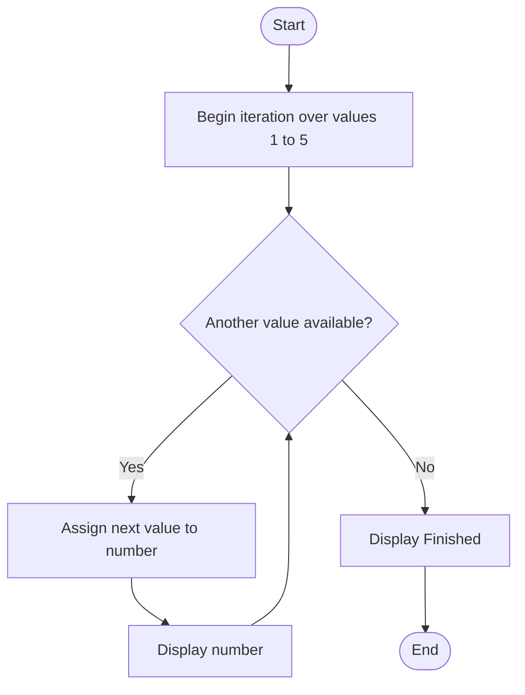
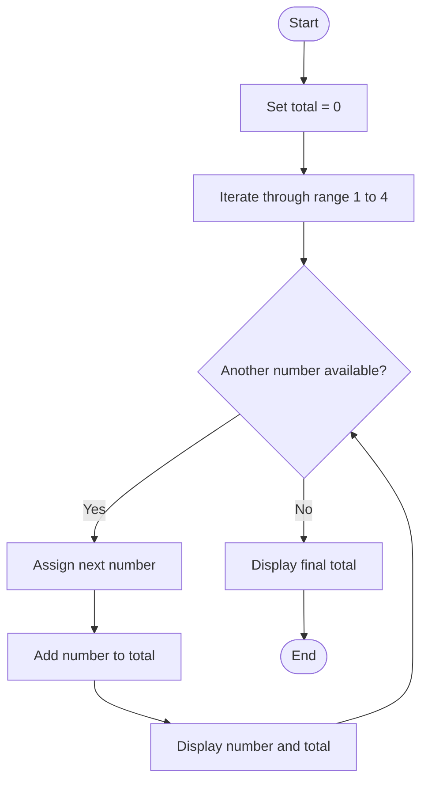
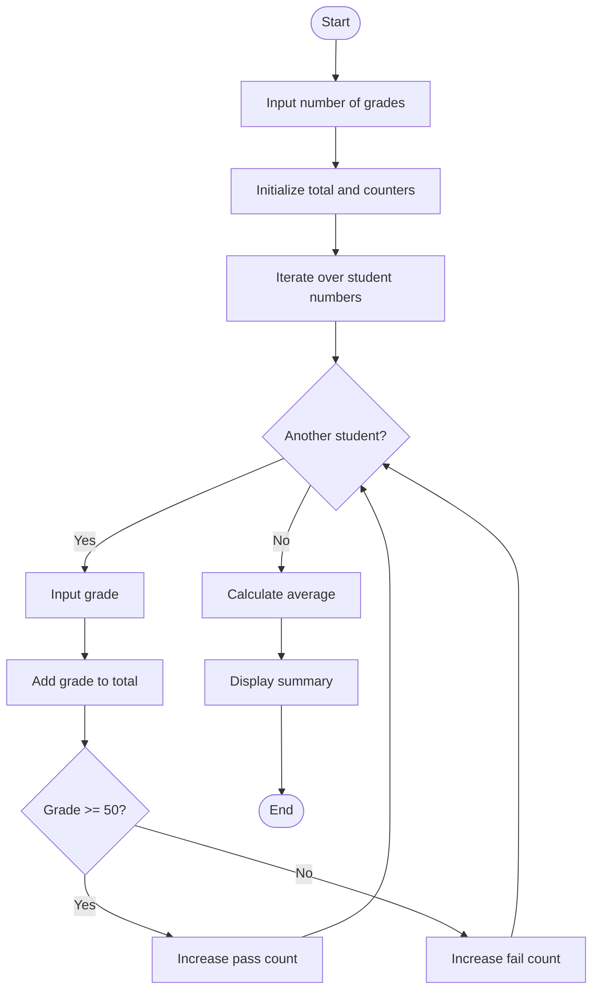
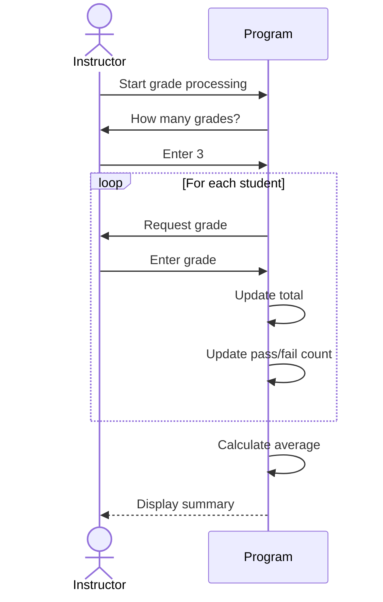

# PROG 1700 — Logic and Programming

# Workshop 05-02 — For Loops and Ranges

## 1. Workshop Details

| Field                       | Details                                          |
| --------------------------- | ------------------------------------------------ |
| **Course**            | PROG 1700 — Logic and Programming               |
| **Instructor**        | Davis Boudreau                                   |
| **Workshop**          | WS05-02 — For Loops and Ranges                  |
| **Series**            | Workshop 05 — Loops and Iteration (Part 2 of 4) |
| **Estimated Time**    | 120–150 minutes                                 |
| **Delivery**          | Self-guided, instructor-facilitated              |
| **Development Tools** | Python 3, VS Code, Git, GitHub, Mermaid          |
| **Workshop Filename** | `sa-itos-ws05-02-for-loops-and-ranges.md`      |
| **Exercise Folder**   | `ws05-02-for-loops-and-ranges`                 |

---

## 2. Workshop Overview

### Purpose

In WS05-01, you learned how `while` loops repeat instructions while a condition remains true. You also used counters, accumulators, VS Code Run and Debug, and Mermaid diagrams to visualize program execution.

In this workshop, you will explore **`for` loops** and Python's **`range()` function**.

You will discover how a `for` loop can simplify repetition when you know how many times an operation should execute.

You will continue using three perspectives:

1. **Python code** — instructions that implement repetition.
2. **VS Code Run and Debug** — the execution of statements and changing variable values.
3. **Mermaid diagrams** — visual representations of program logic and interactions.

### Real-World Use Case: Student Grade Processing

An instructor needs to process a known number of student grades.

The application should:

- Ask how many grades will be entered.
- Request each grade using a `for` loop.
- Calculate the total and average.
- Count passing and failing grades.
- Display a summary.

You will develop this application progressively.

### Learning Objectives

By the end of this workshop, you should be able to:

- Explain the purpose of a `for` loop.
- Use `range()` to control repetition.
- Distinguish `while` loops from `for` loops.
- Use counters and accumulators within `for` loops.
- Iterate over a Python list.
- Use conditional statements inside loops.
- Debug `for` loops using VS Code.
- Inspect changing variables in the Variables pane.
- Create Mermaid flowcharts and sequence diagrams.
- Compare program execution with visual diagrams.
- Test and document program behaviour.

---

## 3. Learning Outcomes Addressed

**Primary Learning Outcome**

**LO6:** Design and implement loops within software applications to perform repetitive tasks.

**Supporting Learning Outcomes**

- **LO1:** Translate logic principles into programming code.
- **LO2:** Perform input/output operations.
- **LO3:** Store data using appropriate data structures.
- **LO4:** Implement conditional logic.
- **LO7:** Implement debugging techniques using an IDE.

---

## 4. Prior Knowledge Check

Before beginning, make sure you can:

- Create and run Python files in VS Code.
- Write a basic `while` loop.
- Use counters and accumulators.
- Use `if`, `elif`, and `else`.
- Set breakpoints in VS Code.
- Inspect variables and use Step Over (`F10`).
- Create and preview Mermaid diagrams.

### Quick Review

Consider:

```python
count = 1

while count <= 5:
    print(count)
    count = count + 1
```

**Predict:**

1. How many times does the loop execute?
2. What variable controls repetition?
3. What happens if the counter update is removed?
4. Could this program be written with fewer lines?

Record your answers in the Workshop Worksheet.

---

## 5. Concepts and Theory

### 5.1 What Is a `for` Loop?

A `for` loop processes values from a sequence or another iterable.

When combined with `range()`, it is useful for repeating an operation a known number of times.

Example:

```python
for number in range(1, 6):
    print(number)
```

Expected output:

```text
1
2
3
4
5
```

Unlike the `while` loop example, you do not need to manually update a counter.

### 5.2 Understanding `range()`

The general form is:

```python
range(start, stop, step)
```

| Argument  | Purpose                     |
| --------- | --------------------------- |
| `start` | First value, inclusive      |
| `stop`  | Ending boundary, exclusive  |
| `step`  | Amount added between values |

Examples:

```python
range(5)          # 0, 1, 2, 3, 4
range(1, 6)       # 1, 2, 3, 4, 5
range(2, 11, 2)   # 2, 4, 6, 8, 10
range(5, 0, -1)   # 5, 4, 3, 2, 1
```

**Important:** The `stop` value is not included.

### 5.3 Comparing `while` and `for`

**Using `while`:**

```python
count = 1

while count <= 5:
    print(count)
    count += 1
```

**Using `for`:**

```python
for count in range(1, 6):
    print(count)
```

Both produce the same output.

Use a `for` loop when iterating over values or when the number of repetitions is known.

Use a `while` loop when repetition depends on a condition that may require an unknown number of attempts.

### 5.4 Standard Pseudocode

```text
BEGIN
    FOR number FROM 1 TO 5 DO
        DISPLAY number
    END FOR

    DISPLAY "Finished"
END
```

### 5.5 Mermaid Flowchart



The flowchart represents how Python repeatedly obtains the next value from `range()` until no values remain.

---

# 6. Workshop Activities

## Activity 1 — Your First `for` Loop

**Exercise File:** `counting_with_for.py`

### Step 1 — Prepare Your Workspace

1. Open VS Code.
2. Open your PROG 1700 GitHub repository.
3. Create the folder `ws05-02-for-loops-and-ranges`.
4. Create `counting_with_for.py`.
5. Open **Terminal → New Terminal**.

### Step 2 — Enter the Code

```python
for number in range(1, 6):
    print("Number:", number)

print("Counting complete!")
```

Save using `Ctrl+S`.

### Step 3 — Predict

Record:

- What is the first value of `number`?
- What is the last value?
- How many iterations occur?
- What happens after the loop?

### Step 4 — Run

```bash
python counting_with_for.py
```

Use `python3` instead if required by your environment.

Expected output:

```text
Number: 1
Number: 2
Number: 3
Number: 4
Number: 5
Counting complete!
```

### Step 5 — Experiment

Modify the program to:

1. Print numbers 1 through 10.
2. Print numbers 5 through 15.
3. Print numbers 0 through 4.
4. Print numbers 10 through 1.

**Hint:** For descending values, use a negative step.

After each change, predict, save, run, and record the result.

**Checkpoint:** Explain why `range(1, 6)` produces five values rather than six.

---

## Activity 2 — Exploring `range()` and Step Values

**Exercise File:** `range_experiments.py`

### Step 1 — Create the Program

```python
print("Counting by twos:")

for number in range(2, 11, 2):
    print(number)

print("Counting backwards:")

for number in range(5, 0, -1):
    print(number)
```

### Step 2 — Predict

What values will appear in each section?

### Step 3 — Run

Expected output:

```text
Counting by twos:
2
4
6
8
10
Counting backwards:
5
4
3
2
1
```

### Step 4 — Investigate

Experiment with:

```python
range(1, 10, 3)
range(10, 0, -2)
range(5)
range(3, 3)
```

For each example:

1. Predict the sequence.
2. Modify the program.
3. Run it.
4. Record the actual sequence.

### Step 5 — Debugging Question

Why does this loop print nothing? because you dont have anything in quotes for it to print

```python
for number in range(1, 10, -1):
    print(number)
```

**Hint:** Consider whether the step moves toward or away from the stop boundary.

**Checkpoint:** Explain the relationship between `start`, `stop`, and `step`.

---

## Activity 3 — Run and Debug: Inspecting a `for` Loop

**Exercise File:** `debug_for_loop.py`

### Step 1 — Create the Program

```python
total = 0

for number in range(1, 5):
    total = total + number
    print("Number:", number, "Total:", total)

print("Final total:", total)
```

### Step 2 — Predict

Calculate the expected total before running.

### Step 3 — Run Normally

Expected output:

```text
Number: 1 Total: 1
Number: 2 Total: 3
Number: 3 Total: 6
Number: 4 Total: 10
Final total: 10
```

### Step 4 — Set a Breakpoint

1. Open `debug_for_loop.py`.
2. Click beside the line:

   ```python
   total = total + number
   ```
3. Confirm that the red breakpoint indicator appears.

### Step 5 — Start Debugging

1. Open the **Run and Debug** panel.
2. Press `F5`.
3. Select **Python Debugger** and **Python File** if prompted.

### Step 6 — Inspect the Variables Pane

Find:

- `number`
- `total`

At the first breakpoint, you should observe:

```text
number = 1
total = 0
```

### Step 7 — Step Through Execution

Press `F10` to execute the accumulator statement.

Observe the new value of `total`.

Continue stepping through the loop.

Notice how:

- `number` receives the next value from `range()`.
- `total` increases.
- The program returns to the loop.
- Execution eventually moves beyond the loop.

### Step 8 — Complete the Trace Table

| Iteration | `number` | Total Before | Total After |
| --------- | ---------: | -----------: | ----------: |
| 1         |          1 |            0 |           1 |
| 2         |          2 |            1 |           3 |
| 3         |          3 |            3 |           6 |
| 4         |          4 |            6 |          10 |

### Step 9 — Explain

Record:

1. What changes automatically in a `for` loop?
2. Which variable is the accumulator?
3. How does the Variables pane confirm your trace table?
4. What happens when the final range value has been processed?

**Checkpoint:** Demonstrate that you can inspect and trace a `for` loop using VS Code.

---

## Activity 4 — Create a Mermaid `for` Loop Flowchart

**Diagram File:** `for_loop_flowchart.md`

### Step 1 — Create the Markdown File

Create `for_loop_flowchart.md`.

Enter:

````markdown
# For Loop Flowchart


````

### Step 2 — Preview

1. Save the file.
2. Press `Ctrl+Shift+V` to open Markdown Preview.
3. If Mermaid rendering is unavailable, use a compatible VS Code extension or https://mermaid.live.
4. In Mermaid Live Editor, paste the diagram definition without the Markdown fences.

### Step 3 — Compare the Diagram with Python

Open `debug_for_loop.py` beside the diagram.

Identify:

- Initialization.
- Iteration.
- Accumulator update.
- Output.
- Loop termination.

### Step 4 — Modify the Program

Change:

```python
range(1, 5)
```

to:

```python
range(2, 11, 2)
```

Predict the new total.

Run and debug the program.

### Step 5 — Update the Flowchart

Modify the diagram to show iteration over the new sequence.

### Step 6 — Record Your Findings

Answer:

1. Which part of the flowchart represents repetition?
2. Why does execution return to the iteration check?
3. How does the diagram represent the loop ending?
4. Does your revised diagram match the actual program?

**Checkpoint:** Create and revise a Mermaid flowchart that accurately represents a working `for` loop.

---

## Activity 5 — Iterating Over Lists

**Exercise File:** `grade_list_iteration.py`

A list stores multiple values in a single variable.

A `for` loop can process each value without requiring a numeric counter.

### Step 1 — Create the Program

```python
grades = [80, 90, 70, 85]

total = 0

for grade in grades:
    print("Processing grade:", grade)
    total = total + grade

average = total / len(grades)

print("Number of grades:", len(grades))
print("Total:", total)
print("Average:", average)
```

### Step 2 — Predict

Before running:

1. How many grades are stored?
2. What is the expected total?
3. What is the expected average?

### Step 3 — Run

Expected output:

```text
Processing grade: 80
Processing grade: 90
Processing grade: 70
Processing grade: 85
Number of grades: 4
Total: 325
Average: 81.25
```

### Step 4 — Investigate the List

Change the list to:

```python
grades = [100, 75, 60, 90, 85]
```

Predict and verify the new average.

### Step 5 — Add Conditional Logic

Modify the loop to display:

- `"Pass"` when the grade is 50 or higher.
- `"Fail"` when the grade is below 50.

**Hint:**

```python
if grade >= 50:
    print("Pass")
else:
    print("Fail")
```

### Step 6 — Debug

Set a breakpoint inside the loop.

Inspect:

- `grades`
- `grade`
- `total`

Observe how `grade` changes as the loop processes each list item.

**Checkpoint:** Explain how a `for` loop processes a list differently from a numeric `range()`.

---

## Activity 6 — Student Grade Processing Application

**Exercise File:** `grade_processor_for.py`

You will now improve the application developed in WS05-01.

### Step 1 — Requirements

The application must:

1. Ask how many grades will be entered.
2. Use a `for` loop to request each grade.
3. Calculate the total.
4. Calculate the average.
5. Count passing grades.
6. Count failing grades.
7. Display a summary.

For this exercise, assume the user enters a positive number of grades and valid numeric grade values.

### Step 2 — Review the Pseudocode

```text
BEGIN
    PROMPT for number of grades
    READ number_of_grades

    SET total TO 0
    SET pass_count TO 0
    SET fail_count TO 0

    FOR student_number FROM 1 TO number_of_grades DO
        PROMPT for grade
        READ grade

        SET total TO total + grade

        IF grade >= 50 THEN
            SET pass_count TO pass_count + 1
        ELSE
            SET fail_count TO fail_count + 1
        END IF
    END FOR

    SET average TO total / number_of_grades

    DISPLAY average
    DISPLAY pass_count
    DISPLAY fail_count
END
```

### Step 3 — Review the Flowchart



### Step 4 — Create the Python Program

```python
number_of_grades = int(input("How many grades? "))

total = 0
pass_count = 0
fail_count = 0

for student_number in range(1, number_of_grades + 1):
    print("Student", student_number)

    grade = int(input("Enter grade: "))

    total = total + grade

    if grade >= 50:
        pass_count = pass_count + 1
    else:
        fail_count = fail_count + 1

average = total / number_of_grades

print("Number of grades:", number_of_grades)
print("Average grade:", average)
print("Passing grades:", pass_count)
print("Failing grades:", fail_count)
```

### Step 5 — Test

Use:

```text
How many grades? 4
Student 1
Enter grade: 80
Student 2
Enter grade: 45
Student 3
Enter grade: 90
Student 4
Enter grade: 60
```

Expected summary:

```text
Number of grades: 4
Average grade: 68.75
Passing grades: 3
Failing grades: 1
```

### Step 6 — Debug

1. Set a breakpoint on:

   ```python
   total = total + grade
   ```
2. Press `F5`.
3. Inspect:

   - `student_number`
   - `grade`
   - `total`
   - `pass_count`
   - `fail_count`
4. Use `F10` to step through the conditional logic.
5. Observe which counter changes for each grade.
6. Compare the final variable values with the printed summary.

### Step 7 — Create a Mermaid Flowchart

**Diagram File:** `grade_processor_for_flowchart.md`

Use the supplied flowchart as a starting point.

Modify it to include the actual program's:

- Student number iteration.
- Grade input.
- Pass/fail decision.
- Counter updates.
- Average calculation.
- Final summary.

### Step 8 — Create a Mermaid Sequence Diagram

**Diagram File:** `grade_processor_for_sequence.md`

Begin with:

````markdown
# Grade Processor Sequence Diagram


````

Preview the diagram.

Compare the interactions with the actual Python program.

### Step 9 — Independent Challenge

Modify the program to display:

- The highest grade.
- The lowest grade.

Use conditional statements inside the loop.

**Hint:** You can initialize the highest and lowest values using the first grade entered.

Update your Mermaid flowchart to represent the new logic.

**Checkpoint:** Demonstrate that your code, debugger observations, flowchart, and sequence diagram are consistent.

---

## 7. Testing and Verification

Test your completed Grade Processing application.

| Test | Grades         | Expected Average | Pass | Fail |
| ---- | -------------- | ---------------: | ---: | ---: |
| A    | 80, 45, 90, 60 |            68.75 |    3 |    1 |
| B    | 100, 100       |            100.0 |    2 |    0 |
| C    | 40, 30, 20     |             30.0 |    0 |    3 |
| D    | 50             |             50.0 |    1 |    0 |

For each test:

1. Predict the results.
2. Run the program.
3. Record the actual results.
4. Compare the results.
5. Investigate any discrepancies.

### Debugging Investigation

Consider:

```python
total = 0

for number in range(1, 5):
    total = number

print(total)
```

The programmer intended to calculate the sum of the numbers from 1 through 4.

**Questions:**

1. What output will this program produce?
2. Why is the result incorrect?
3. Which statement should be changed?
4. How would you use the Variables pane to demonstrate the error?

Correct the program and verify that the final total is 10.

---

## 8. Reflection Questions

Complete the reflection section of your Workshop Worksheet.

1. What is the difference between a `while` loop and a `for` loop?
2. Why does `range(1, 6)` stop at 5?
3. What is the purpose of the `step` argument?
4. How does a `for` loop process a list?
5. What did the Variables pane reveal about loop execution?
6. How did Step Over help you understand the accumulator?
7. How did your Mermaid flowchart represent repetition?
8. What did the sequence diagram reveal about user/program interactions?
9. What was the most challenging activity?

---

## 9. Student Deliverables & Submission Guidelines

All students are required to complete the **Workshop Worksheet** as they work through the activities. The worksheet is an important part of the learning process and should document predictions, observations, test results, debugging findings, and reflections.

**In-Class Students:** Students attending the scheduled workshop must complete the worksheet while working through the activities. At the end of the workshop, the instructor will facilitate a class review to discuss findings, solutions, and key learning concepts. **Worksheet submission is not required** for students attending in class unless otherwise directed.

**Absent Students:** Students who miss the scheduled workshop must complete all activities independently, including the entire worksheet, and **submit the completed worksheet to Brightspace** as evidence of their learning.

All students must complete the required programming exercises and commit/push their technical work to GitHub, where applicable.

### Required Technical Files

Organize your files in:

`ws05-02-for-loops-and-ranges/`

```text
ws05-02-for-loops-and-ranges/
├── counting_with_for.py
├── range_experiments.py
├── debug_for_loop.py
├── for_loop_flowchart.md
├── grade_list_iteration.py
├── grade_processor_for.py
├── grade_processor_for_flowchart.md
└── grade_processor_for_sequence.md
```

Commit and push the completed files to GitHub.

---

## 10. Evaluation Criteria

Workshop participation and completion are evaluated using the standard A/P/T/F/R criteria.

| Criterion                                   | Description                                                |
| ------------------------------------------- | ---------------------------------------------------------- |
| **A — Attendance**                   | Attendance and participation in the scheduled workshop     |
| **P — Participation**                | Engagement with activities, discussions, and review        |
| **T — Task Progress**                | Completion and testing of Python and Mermaid activities    |
| **F — Focus & Professional Conduct** | Productive work habits, collaboration, and professionalism |
| **R — Reflection**                   | Worksheet observations, debugging findings, and reflection |

---

## 11. Completion and Exit Evidence

Before completing the workshop, confirm that you can:

- [ ] Explain the purpose of a `for` loop.
- [ ] Use `range(start, stop, step)`.
- [ ] Compare `while` and `for` loops.
- [ ] Use counters and accumulators.
- [ ] Iterate over a list.
- [ ] Use conditions inside loops.
- [ ] Run and debug a `for` loop in VS Code.
- [ ] Inspect variables in the Variables pane.
- [ ] Step through execution with `F10`.
- [ ] Create and revise Mermaid flowcharts.
- [ ] Create a Mermaid sequence diagram.
- [ ] Test a Grade Processing application.
- [ ] Complete the Workshop Worksheet.
- [ ] Commit and push technical evidence to GitHub.

### Next Workshop

**WS05-03 — Loop Control and Nested Loops**

You will explore `break`, `continue`, nested loops, loop tracing, and more advanced debugging and visualization.

---
