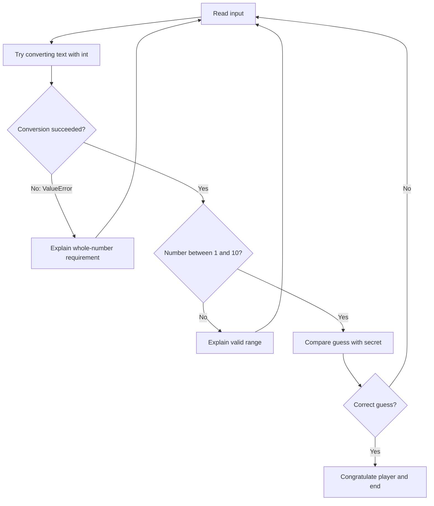

# PROG 1700 — Logic and Programming

## Workshop 04-03 — Exception Handling with `try` / `except`

### 1. Workshop Details

| Field                | Details                                                                                                     |
| -------------------- | ----------------------------------------------------------------------------------------------------------- |
| Course               | PROG 1700 — Logic and Programming                                                                          |
| Instructor           | Davis Boudreau                                                                                              |
| Series               | Workshop 04 — Error Handling (Part 3 of 4)                                                                 |
| Workshop             | 04-03 — Exception Handling with `try` / `except`                                                       |
| Type                 | Self-guided, hands-on programming                                                                           |
| Estimated time       | 75–90 minutes                                                                                              |
| Tools                | Python 3, VS Code, Git, GitHub                                                                              |
| Prerequisite         | Workshops 04-01 and 04-02                                                                                   |
| Student deliverables | Worksheet completed by all; GitHub technical evidence; Brightspace worksheet submission for absent students |
| Evaluation           | A — Attendance; P — Participation; T — Task Progress; F — Focus & Professional Conduct; R — Reflection |

---

### 2. Overview

#### Purpose and real-world use case

You are maintaining a **Number Guessing Game** for a small software project. In Workshop 04-02, you checked input using `.isdigit()` and range conditions. Now your team wants you to use a common Python technique: **attempt the conversion and handle the error if it fails**.

In real applications, users enter unexpected values, files may be missing, and operations may fail. Good software should respond predictably to expected problems rather than abruptly terminate. Today you will learn to catch a specific conversion error with `try` and `except ValueError`, then return the player to the game.

**Today's goal:** Replace the digit-checking approach with a carefully scoped `try`/`except` block, keep the 1–10 range rule, and demonstrate that the game continues after invalid text input.

#### Learning objectives

By the end of this workshop, you can:

1. Distinguish a runtime exception from a logical validation failure.
2. Explain the roles of `try`, `except`, and `ValueError`.
3. Read a Python traceback to identify a failing operation.
4. Catch a specific conversion exception without hiding unrelated bugs.
5. Combine exception handling, range validation, conditions, and loops.
6. Test expected and unexpected inputs systematically.
7. Investigate a broken exception handler using VS Code.
8. Commit and push working code to GitHub.

### 3. Learning Outcomes Addressed

- **Outcome 1:** Translate logic principles into programming code to solve problems.
- **Outcome 2:** Perform input/output operations within software applications.
- **Outcome 4:** Implement conditional logic to control program behaviour.
- **Outcome 6:** Design and implement loops to perform repetitive tasks.
- **Outcome 7:** Implement debugging techniques using an IDE.

---

### 4. Prior Knowledge Check

Record answers in your Workshop Worksheet before running code:

1. What does `input()` return?
2. What happens when Python evaluates `int("hello")`?
3. What does `.isdigit()` do, and what limitation did you observe in Workshop 04-02?
4. Why does a guessing game reject `11` even though it is a whole number?
5. What does `continue` do inside a `while` loop?

Return to your answers at the end of the workshop and correct anything you misunderstood.

---

### 5. Concepts & Theory — Responding to Runtime Exceptions

An **exception** is an event that interrupts the normal flow of a program. Python raises `ValueError` when a value has the wrong format for an operation, such as converting the text `"banana"` into an integer.

```python
number = int("banana")  # Raises ValueError
```

A `try` block contains code that **might raise an exception**. An `except` block describes what to do **if that specific exception occurs**.

```python
try:
    number = int(input("Enter a whole number: "))
    print("Accepted:", number)
except ValueError:
    print("Please enter a whole number.")
```

**Important distinctions:**

| Situation                          | Example                       | Correct response                               |
| ---------------------------------- | ----------------------------- | ---------------------------------------------- |
| Conversion exception               | `int("hello")`              | Catch `ValueError`                           |
| Out-of-range value                 | `int("15")` in a 1–10 game | Use an `if` range check                      |
| Correctly formatted, allowed input | `int("5")`                  | Continue with game logic                       |
| Programming mistake                | Misspelled variable name      | Debug and fix the code, not suppress the error |

**Do not use a bare `except:` for this workshop.** Catch `ValueError` specifically so unexpected programming errors remain visible.

#### Flow of an exception handler



---

### 6. Guided Tutorials & Demonstrations

**Learning routine for every activity:** Predict → Code → Save → Run → Observe → Investigate → Correct → Record.

#### Activity 1 — Prepare your VS Code workspace (5–10 minutes)

1. Open **VS Code** and select **File → Open Folder** (on macOS, use the equivalent File menu command).
2. Open the course repository you used for Workshops 04-01 and 04-02.
3. In the Explorer panel, create a folder named `workshop_04_03_exception_handling`.
4. Inside it, create `guessing_game.py` and `exception_practice.py`.
5. Open **Terminal → New Terminal**.
6. Verify Python is installed by entering `python --version`. If your system uses `python3`, use that command instead throughout this workshop. On Windows, `py` may also work.
7. Navigate to the new folder in the terminal. For example, from your repository root:

   ```bash
   cd workshop_04_03_exception_handling
   ```
8. Save your files with **Ctrl+S** (Windows/Linux) or **Cmd+S** (macOS).

**Checkpoint:** You can see both files in the VS Code Explorer and can run a Python script from the terminal.

#### Activity 2 — Observe an unhandled exception (10 minutes)

Open `exception_practice.py` and enter:

```python
raw_value = input("Enter a whole number: ")
number = int(raw_value)
print("Your number is:", number)
```

1. **Predict:** What will happen for input `7`? What will happen for `hello`? Record both predictions. 7 will work and hello will not
2. Save the file.
3. Run `python exception_practice.py` (or `python3 exception_practice.py`).
4. Enter `7` and observe `Your number is: 7`.
5. Run the script again. Enter `hello`.
6. Locate the final line of the traceback: it should identify `ValueError` and report that `hello` is not a valid integer literal.
7. In your worksheet, record the exception type, failing line, and reason.

**Checkpoint:** You can explain why the first run succeeds and the second fails.

#### Activity 3 — Catch `ValueError` (10–15 minutes)

Replace the contents of `exception_practice.py` with:

```python
try:
    raw_value = input("Enter a whole number: ")
    number = int(raw_value)
    print("Your number is:", number)
except ValueError:
    print("Invalid input: enter a whole number.")

print("The program reached the end.")
```

1. Predict the output for `7` and `hello`.
2. Save and run the file twice, once for each input.
3. For `7`, expect:

   ```text
   Enter a whole number: 7
   Your number is: 7
   The program reached the end.
   ```
4. For `hello`, expect:

   ```text
   Enter a whole number: hello
   Invalid input: enter a whole number.
   The program reached the end.
   ```
5. Explain in your worksheet why the last `print()` runs in both cases.
6. **Experiment:** Enter `4.5`. Observe that `int("4.5")` also raises `ValueError`.

**Checkpoint:** The script handles invalid text without displaying a traceback.

#### Activity 4 — Add repeated attempts (10 minutes)

A single prompt does not let the user recover immediately. Replace `exception_practice.py` with:

```python
while True:
    try:
        raw_value = input("Enter a whole number: ")
        number = int(raw_value)
        print("Accepted:", number)
        break
    except ValueError:
        print("Please try again using a whole number.")

print("Input accepted. Continuing...")
```

1. Predict what happens if you enter `hello`, then `4.5`, then `8`.
2. Save and run the program. Enter those three values in order.
3. Confirm that the first two inputs trigger feedback and another prompt, and `8` ends the loop.
4. Record what `break` does and why it is **not** executed after `ValueError`.

**Checkpoint:** The program stays active until the user enters a convertible integer.

---

### 7. Workshop Challenge — Upgrade the Number Guessing Game

#### Activity 5 — Rebuild the game with exception handling (15–20 minutes)

Open `guessing_game.py`. Type this complete starting program. **Do not simply paste without reading:** identify the input step, conversion step, range check, comparison logic, and loop exit.

```python
import random

secret = random.randint(1, 10)

while True:
    try:
        guess = int(input("Guess a number between 1 and 10: "))
    except ValueError:
        print("That's not a whole number. Please try again.")
        continue

    if not 1 <= guess <= 10:
        print("Out of range. Enter a number from 1 to 10.")
        continue

    if guess < secret:
        print("Too low!")
    elif guess > secret:
        print("Too high!")
    else:
        print("You got it!")
        break
```

**Build and verify:**

1. Save the file.
2. Run `python guessing_game.py` (or your platform's equivalent).
3. Enter `hello`: expect a whole-number message and another prompt.
4. Enter `0`: expect an out-of-range message and another prompt.
5. Enter `11`: expect an out-of-range message and another prompt.
6. Enter `5`: expect either `Too low!`, `Too high!`, or `You got it!`, depending on the random secret.
7. Keep guessing until the game prints `You got it!` and exits.
8. In your worksheet, explain **why the range check is outside the `try` block** and what `continue` accomplishes in each rejection branch.

**Connection to Workshop 04-02:** In that workshop, `.isdigit()` checked the text before conversion. Here, `int()` attempts conversion and `except ValueError` handles conversion failure. **Neither approach replaces the separate range check.**

#### Activity 6 — Test with a known secret (10 minutes)

Temporarily change:

```python
secret = random.randint(1, 10)
```

to:

```python
secret = 5  # Testing only
```

Run the program and enter the following sequence, recording **expected and actual output** for every entry:

| Input     | Expected behaviour              |
| --------- | ------------------------------- |
| `hello` | Whole-number error; ask again   |
| `4.5`   | Whole-number error; ask again   |
| `0`     | Out-of-range message; ask again |
| `11`    | Out-of-range message; ask again |
| `3`     | `Too low!`; ask again         |
| `8`     | `Too high!`; ask again        |
| `5`     | `You got it!`; end game       |

Also test the boundaries `1` and `10` in a new run. With a secret of `5`, both are allowed guesses (but incorrect), so the game should print `Too low!` or `Too high!` rather than `Out of range`.

**Restore** `secret = random.randint(1, 10)` after testing. Save and rerun.

#### Activity 7 — Debugging investigation: a handler that misses the error (10 minutes)

In `exception_practice.py`, enter this **deliberately broken** program:

```python
raw_value = input("Enter a whole number: ")
number = int(raw_value)

try:
    print("Your number is:", number)
except ValueError:
    print("Please enter a whole number.")
```

1. Predict whether entering `hello` will be handled.
2. Save, run, and enter `hello`.
3. Observe the traceback. The `except` block does **not** run.
4. Identify the line that raises `ValueError` and explain why the `try` block cannot catch it.
5. Correct the program by moving the conversion **inside** `try`:

   ```python
   raw_value = input("Enter a whole number: ")

   try:
       number = int(raw_value)
       print("Your number is:", number)
   except ValueError:
       print("Please enter a whole number.")
   ```
6. Save and retest `hello` and `6`. Record evidence of both results.
7. Optional VS Code debugger: set a breakpoint on `number = int(raw_value)`, start **Run and Debug → Python File**, enter `hello`, and observe where execution stops or reports the exception. Repeat with `6` and inspect `raw_value` and `number` as you step through.

**Debugging worksheet prompts:** What did you expect? What actually happened? Which line caused it? Why did the original handler fail? What did you change? How did you verify the fix?

---

### 8. Independent Application — Improve User Feedback

Working in `guessing_game.py`, make these changes **without copying a complete solution**:

1. Add `invalid_attempts = 0` before the loop.
2. Increase this counter by one whenever a user enters **non-convertible text** or a number **outside 1–10**.
3. Do not increase the counter for valid but incorrect guesses.
4. When the player wins, print the number of invalid attempts.
5. Test with `secret = 5` and inputs `hello`, `15`, `3`, `5`. The expected invalid-attempt count is **2**.
6. Restore the random secret and save your final version.

**Hints:** There are two rejection paths: `except ValueError` and the out-of-range `if`. Both should update the same counter. Keep the counter outside the loop so it is not reset on each guess.

**Optional extension:** Add a separate `valid_guesses` counter. For the same test sequence, the expected valid-guess count is **2** (`3` and `5`).

---

### 9. Checkpoints & Verification

Use your worksheet to mark each item and record evidence:

- [ ] I reproduced a `ValueError` and identified the failing line in a traceback.
- [ ] I explained what `try` and `except ValueError` do.
- [ ] I verified that a handled conversion error does not crash the program.
- [ ] I used a loop to allow another attempt after an error.
- [ ] I integrated exception handling into the guessing game.
- [ ] I kept the 1–10 range validation separate from conversion handling.
- [ ] I tested text, decimal text, out-of-range values, boundaries, low/high guesses, and a win.
- [ ] I repaired the deliberately broken exception handler and documented the investigation.
- [ ] I completed the independent invalid-attempt counter challenge.
- [ ] I restored random number generation, saved, committed, and pushed my files.

---

### 10. Reflection Questions

Answer in complete sentences in your Workshop Worksheet:

1. What is a `ValueError`, and which line of your code can raise it?
2. Why is catching `ValueError` better here than using a bare `except:`?
3. Why does the game still need a range check after a successful `int()` conversion?
4. How does `continue` help the game recover from invalid input?
5. Compare `.isdigit()` validation from Workshop 04-02 with `try`/`except` in this workshop. What is different?
6. What went wrong in the deliberately broken exception handler? How did you find and fix it?
7. Which test case surprised you, and what did you learn from it?
8. How could this exception-handling pattern be useful in a different application?

---

### 11. Student Deliverables & Submission Guidelines

All students are required to complete the **Workshop Worksheet** as they work through the activities. The worksheet is an important part of the learning process and should document predictions, observations, test results, debugging findings, and reflections.

**In-Class Students:** Students attending the scheduled workshop must complete the worksheet while working through the activities. At the end of the workshop, the instructor will facilitate a class review to discuss findings, solutions, and key learning concepts. **Worksheet submission is not required** for students attending in class unless otherwise directed.

**Absent Students:** Students who miss the scheduled workshop must complete all activities independently, including the entire worksheet, and **submit the completed worksheet to Brightspace** as evidence of their learning.

All students must complete the required programming exercises and commit/push their technical work to GitHub, where applicable. For this workshop, save `exception_practice.py` and `guessing_game.py` in your Workshop 04-03 folder, commit and push the files, and verify that they appear in your GitHub repository.

---

### 12. Evaluation Criteria

| Criterion                                   | Evidence                                                                                                    |
| ------------------------------------------- | ----------------------------------------------------------------------------------------------------------- |
| **A — Attendance**                   | Present and engaged during workshop activities, or completes the independent make-up requirements if absent |
| **P — Participation**                | Predicts results, tests multiple inputs, and investigates failures                                          |
| **T — Task Progress**                | Completes guided exception exercises, guessing-game integration, testing, and independent challenge         |
| **F — Focus & Professional Conduct** | Works systematically, tests safely, and documents changes                                                   |
| **R — Reflection / Exit Evidence**   | Explains exception handling, range validation, and debugging decisions in the worksheet                     |

---

### 13. Completion & Exit Evidence

Before leaving, demonstrate that you can:

- Show a program that catches `ValueError` without crashing.
- Explain which statements belong inside the `try` block.
- Show the game rejecting both `hello` and `15` for **different reasons**.
- Demonstrate that valid guesses still receive low/high/correct feedback.
- Explain your test results and debugging correction.
- Show the completed worksheet and GitHub commit.

**Exit question:** A ticket-booking program asks for the number of seats to reserve, from 1 through 6. Which part of today's code catches text such as `two`, and which part rejects `9`? Explain why both are necessary.

**Next workshop: 04-04 — Integrated Error Handling, Testing & Refinement.** You will consolidate the complete game, design more systematic tests, use the VS Code debugger, and refine the program independently.
